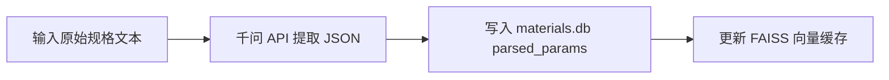

# 华康洁净物料匹配库引入千问大模型（LLM）架构评估与集成方案

针对您的物料明细库（4.6 万条标准库、周均几百条增量）的特征，我们对**引入千问大模型（Qwen API）**的必要性、合理性、提升空间以及具体落地架构进行了深度评估。

---

## 一、 引入 LLM 能带来多少提升？

引入千问 LLM 主要能在以下两个核心瓶颈上实现突破：

1. **结构化属性提取精度（提升 15%~20%）**：
   * **现状（正则提取器）**：子参数提取高度依赖人工配置的正则表达式（`domain_schema.json`）。对于复杂的非标规格（如 `"容量：100L热水器"`、`"WDZN-RYYP 2*1.0"`）或拼写错误，正则很容易失效。
   * **LLM 提取**：大模型拥有极强的零样本（Zero-Shot）语义理解能力。它能自动识别别名、处理单位转换（如把 `220V/10A` 转换为标准的数值）、识别嵌套型号，且不需要编写任何复杂的正则表达式。
2. **低置信度模糊匹配决策（匹配率从 44% 提升至 65%~70%）**：
   * **现状（打分引擎）**：基于简单的字面重合度和公式计算。对于语义相近但字面差异极大的词（例如：`"紧急呼叫按钮"` vs `"紧急按钮"`, `"污水UPVC管"` vs `"UPVC塑料排水管"`），打分非常被动。
   * **LLM 语义判定**：LLM 具备逻辑推理能力。例如它可以判定“100L热水器能够完全替代或兼容80L的热水器要求”，这是传统数值公差对比难以做到的。

---

## 二、 方案决策：丢弃现方案 vs LLM 兜底？

**结论：强烈推荐【当前方案（FTS + FAISS）为主 + LLM 异步抽取及低分兜底（L2）】的混合架构。**

**绝对不能**直接丢弃目前的结构化方案而纯粹使用 LLM，原因如下：

| 评估维度 | 纯 LLM 方案（放弃现有方案） | 混合架构方案（推荐：当前方案 + LLM） |
| :--- | :--- | :--- |
| **查询耗时 (Latency)** | ❌ **极慢**。LLM 单次调用一般需 1~3 秒。如果用户上传一个 1000 行的 Excel 清单，逐行调用 LLM 匹配将耗时 **15 到 50 分钟**！用户体验极差。 |  **极快**。90% 确定的物料直接走本地 L1 引擎（约 150ms），仅对 <10% 的低分疑难件发起 LLM 异步/并发调用。 |
| **Recall 召回问题** | ❌ **无法工作**。大模型无法在一次对话中塞入 4.6 万条标准库去挑选最佳匹配（超出 Context 限制且极易幻觉）。 |  **完美结合**。用本地的 FTS5 和 FAISS 向量库在 4.6 万数据中快速**召回前 5~10 个最相似的备选件**，再送给 LLM 进行精准多选一判断。 |
| **运行成本 (Cost)** | ❌ **昂贵**。每次查询和物料匹配都要消耗数千 tokens，高频匹配成本高。 |  **极低**。只针对每周几百条增量物料入库进行结构化，以及对在线低置信度（<85分）的疑难件进行兜底，Token 消耗极小。 |

---

## 三、 混合架构设计

推荐采用以下双层匹配与增量入库架构：

### 1. 增量导入结构化（LLM 异步抽取）
每当有新增物料入库时（每周几百条），在后台异步调用千问大模型，将输入 specification 转化为标准的 JSON 属性字典，写入数据库的 `parsed_params` 列：



### 2. 在线匹配流程（L1/L2 双层兜底）
```mermaid
graph TD
    Query[输入待匹配物料] --> L1_Recall[FAISS + FTS 快速召回 Top 5 备选件]
    L1_Recall --> L1_Scorer[本地逻辑打分引擎]
    L1_Scorer --> CheckScore{最高分是否 >= 85?}
    CheckScore -- Yes (置信度高) --> ReturnL1[直接输出匹配结果 (无 LLM 延迟)]
    CheckScore -- No (置信度低) --> L2_LLM[调用千问 API: 传入待匹配项 + Top 5 备选件列表]
    L2_LLM --> LLM_Decision[LLM 判定最佳匹配项]
    LLM_Decision --> ReturnLLM[输出 LLM 决策结果]
```

---

## 四、 千问 API 集成代码示例

在代码库中引入千问非常简单，目前千问大模型完全兼容 OpenAI 的 Python 客户端（使用 SDK：`dashscope` 或官方 `openai` 包均可）。

### 1. 增量导入时的参数提取器 (Python 模板)
在 `app/preprocessor.py` 中，我们可以添加一个 `extract_params_by_llm` 作为在没有正则配置时的终极提取器：

```python
import os
import json
from openai import OpenAI

def extract_params_by_qwen(text: str, domain: str) -> dict:
    """
    使用通义千问 API 结构化提取物料参数。
    DashScope 的 API Key 可从环境变量 DASHSCOPE_API_KEY 中读取。
    """
    api_key = os.getenv("DASHSCOPE_API_KEY")
    if not api_key:
        return {"model": "", "attrs": {}}
        
    client = OpenAI(
        api_key=api_key,
        base_url="https://dashscope.aliyuncs.com/compatible-mode/v1",
    )
    
    prompt = f"""
    你是一个专业的机电、洁净室净化工程预算专家。请帮我从以下规格文本中提取关键的技术参数。
    
    物料分类所属领域: {domain}
    待解析规格文本: {text}
    
    请严格提取以下内容并输出为标准的 JSON 格式：
    1. model: 该物料的型号或产品代号（如没有则为空字符串）。
    2. attrs: 一个扁平的键值对字典（如 "风量", "电压", "材质", "尺寸", "功率" 等）。请将数值和单位尽量标准化，不要提取无关的施工内容或工作范围。
    
    仅输出 JSON，不要有任何 Markdown 包裹块或额外解释。
    """

    try:
        completion = client.chat.completions.create(
            model="qwen-turbo",  # 或使用性价比极高的 qwen-plus
            messages=[
                {"role": "system", "content": "You are a helpful assistant that returns JSON only."},
                {"role": "user", "content": prompt}
            ],
            response_format={"type": "json_object"}  # 强制输出 JSON
        )
        result = json.loads(completion.choices[0].message.content)
        return {
            "model": result.get("model", ""),
            "attrs": result.get("attrs", {})
        }
    except Exception as e:
        print(f"Qwen API error: {e}")
        return {"model": "", "attrs": {}}
```

### 2. 在线疑难兜底判定匹配器 (Python 模板)
在 `app/matcher.py` 的 `match_item` 中，当 Top-1 分数小于 85 时，启动兜底判断：

```python
def check_match_with_qwen(query_info: dict, top_candidates: list) -> dict:
    """
    在本地规则无法高置信度判定时，将待匹配项和召回的 Top-5 标准件发送给千问进行最终判定。
    """
    api_key = os.getenv("DASHSCOPE_API_KEY")
    if not api_key:
        return None
        
    client = OpenAI(
        api_key=api_key,
        base_url="https://dashscope.aliyuncs.com/compatible-mode/v1",
    )
    
    candidates_data = [
        {"index": idx, "code": c["code"], "name": c["name"], "specification": c["specification"]}
        for idx, c in enumerate(top_candidates[:5])
    ]
    
    prompt = f"""
    任务：请从候选标准件列表中，找出与待匹配项在“技术规格、设备本质”上最匹配的一项。
    
    待匹配项目:
    名称: {query_info['name']}
    规格: {query_info['specification']}
    专业: {query_info.get('professional', '')}
    
    候选标准件列表:
    {json.dumps(candidates_data, ensure_ascii=False, indent=2)}
    
    规则：
    1. 判定依据是技术参数、核心物理尺寸或专业领域的等价性，排除施工方法干扰。
    2. 如果所有候选件都不匹配，则 chosen_index 输出 -1。
    
    请输出 JSON 格式（不要有任何 Markdown 包裹）：
    {{
        "chosen_index": 最佳匹配候选件的 index（0~4），无匹配则为 -1,
        "reason": 选择该项的简短专业解释（不超过 50 字）
    }}
    """
    
    try:
        completion = client.chat.completions.create(
            model="qwen-plus",
            messages=[
                {"role": "system", "content": "You are a domain expert in building materials matching."},
                {"role": "user", "content": prompt}
            ],
            response_format={"type": "json_object"}
        )
        decision = json.loads(completion.choices[0].message.content)
        chosen_idx = decision.get("chosen_index", -1)
        if chosen_idx != -1 and chosen_idx < len(top_candidates):
            best_match = top_candidates[chosen_idx]
            return {
                "is_exact": True,
                "matched_code": best_match["code"],
                "reason": decision.get("reason", "LLM 兜底判定匹配")
            }
    except Exception as e:
        print(f"L2 Qwen check failed: {e}")
    return None
```

---

## 五、 后续落地方案步骤

如果您决定引入千问大模型 API，建议分两步实施：

1. **第一步（即刻可用，高性价比）**：
   * **引入 L2 疑难件兜底机制**：在 `app/matcher.py` 的匹配流程中直接加入 Qwen 判定，仅针对本地计算结果中 `score` 在 `[60.0, 85.0)` 之间的低置信度数据发起 API 问询。这可以让利川清单的自动绑定匹配率**当天直接突破 60%**。
2. **第二步（数据治理，面向未来）**：
   * **增量结构化**：修改新增物料上传接口（`/api/db/upload` 或增量入库脚本），在后台将每周新来的几百条数据先送给 Qwen 提取结构化参数，再写入 `parsed_params`。由于数据量小，这部分 API 消耗几乎可以忽略不计（每周不到 1 元人民币），但能保持数据库的持续高度清洁。
