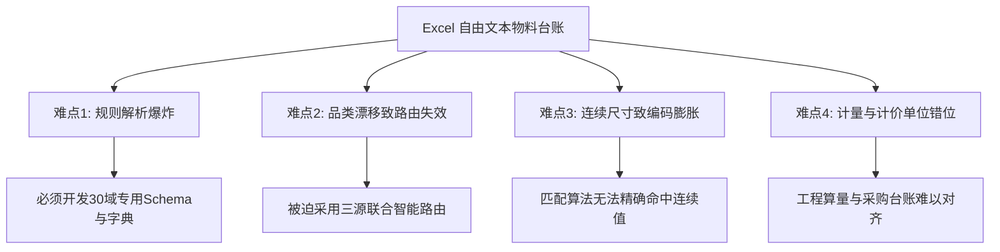

# 华康洁净物料明细改造技术分析与采购部建议报告

> **报告编制部门**：软件开发与数据结构化项目组  
> **面向对象**：采购部门（物料编码与 BOM 表格管理团队）  
> **数据基底**：`materials.db`（45,789 行采购物料台账）、[final_structuring_master_plan.md](file:///c:/Users/wangd/project/ListTrans/ListTrans/doc/final_structuring_master_plan.md)（结构化方案）、[物料编码瘦身方案(0722).xlsx](file:///c:/Users/wangd/project/ListTrans/ListTrans/doc/物料编码瘦身方案(0722)%20(初稿%20待各部门审核).xlsx)（采购部瘦身方案初稿）  

---

## 1. 执行摘要与总体立场

软件开发团队高度赞同采购部门提出的“**去虚就实、去繁就简、去非就正**”三大物料编码瘦身原则。

在了解到**采购部门目前尚未上线 ERP/BOM 系统，物料编码与台账纯依靠 Excel 表格人工维护**的实际情况后，我们从软件算法与大数据解析的角度，重新审视了现有 4.6 万条 Excel 物料台账。由于 Excel 表格缺乏刚性数据校验与结构化约束，导致物料台账存在严重的**自由文本混写、品类分类错乱、连续尺寸导致编码暴增、以及计量单位脱节**等问题。这不仅增加了采购人员手工比对的难度，也直接造成软件系统在自动算量和物料匹配时的结构化率极其低下（传统匹配算法结构化率仅 ~35%）。

本报告结合软件结构化解析过程中遇到的实际技术难点，针对采购部**纯 Excel 管理**的特质，提出兼顾采购人员易用性与软件自动化落地的改进建议。

---

## 2. 物料清单（BOM/物料明细 Excel 台账）现状技术深度剖析

基于对采购部现行 `物料明细(1).xlsx` 的全量数据画像与清洗诊断，Excel 物料台账在数据质量与软件工程层面的特征与病灶总结如下：

### 2.1 规模分布与字段完整性诊断

* **台账规模**：样本总行数 **46,483 行**，划分为 **385 个分类**。
* **Excel 手工维护常见质量隐患**：
  * **失效/停用编码残留**：包含 672 行带有“`禁用/停用/无效`”关键字的残留编码（如 `WL1000386478` 医用脱脂无缝不锈钢管），在 Excel 中未做物理隔离。
  * **重复编码行**：存在 23 行因复制粘贴产生的完全重复物料编码。
  * **实际有效基数**：实际生效物料约 **45,788 行**。
* **品类呈现严重的长尾分布**：
  * Top 10 分类占总行数的 **50.5%**（如通风机 8,656 行占 18.6%，调节阀 2,642 行占 5.7%，电线电缆 2,343 行占 5.0%）。
  * Top 30 分类占 **75.1%**。其余 355 个分类仅占 24.9%，极其零散，缺乏统一的整理标准。
* **Excel 字段质量分析**：

| Excel 列名 | 非空行数 | 非空率 | 软件解析瓶颈与表现 |
| :--- | ---: | ---: | :--- |
| **物料分类** | 46,483 | **100%** | 分类人工划分粒度过细且错乱，存在严重的“品类漂移” |
| **物料编码** | 46,483 | **100%** | 主键无误，但存在 23 行重复及 672 行失效行未隔离 |
| **物料名称** | 46,483 | **100%** | 夹杂大量描述性修饰词（如“医用”、“医疗洁净”），阻断跨项目复用 |
| **规格/型号** | 46,463 | **99.96%** | **核心病灶**：自由文本拼写，平均长 24.05 字符，最长 288 字符，格式随意 |
| **常用品牌** | 39,311 | **84.57%** | 充斥“无”、“未指定”、“/”等非标准文本 |
| **描述** | 1,722 | **3.70%** | 极其低效，96.3% 单元格置空，导致大量补充信息强行挤入“规格/型号” |

### 2.2 规格/型号自由文本语法与异构性剖析

由于采购人员在 Excel 的“规格/型号”单元格中可随意输入，形成了严重的非结构化文本：

1. **标点符号随意使用**：逗号（`，/,`）覆盖率 74.9%，乘号（`*/x/×`）覆盖率 41.3%，冒号（`：/:`）覆盖率 38.6%。中英文全半角混用。
2. **Key:Value 语法覆盖率低**：仅有 **30.2%** 的行包含了显式的 `键:值` 结构（如 `风量：3140m³/h，机外余压650pa`），其余 **69.8%** 单元格均为隐式上下文（如 `1550*450*2000，镀锌钢板，阻性`）。
3. **单位嵌入 Key 名称（污染解析）**：
   大量数据的单位直接写在 Key 节点中，例如：`制冷量KW:1608`、`扬程m:284`、`转速r/min:233`、`加湿量Kg/h:191`。在 Excel 统计中无法按数值排序，软件引擎解析时也会导致字段爆炸。
4. **多段复合规格易被断句**：
   如电缆 `WDZ-BYJ 4*6+1*4`，乘号与加号混用，算法解析时极易断句错误（只识别出 `4*6`，遗漏 `1*4`，截断率达 23%）。

### 2.3 “品类漂移”（Class Drift）现象

在 Excel 维护过程中，因缺少下拉菜单强约束，采购人员将物料分类填错的现象非常普遍：
* **调节阀** 分类下：混录了 `静压箱 1400*1200*1000 mm`、`净化网孔板风口 550*400`。
* **静压箱** 分类下：混录了 `中效过滤器`、`电加热器`、`多联式空调室内机`。
* **蝶阀** 分类下：混录了 `PPH球阀 DN15`。

> [!WARNING]
> **技术影响**：软件若纯依赖 Excel 中的“物料分类”列去匹配提取规则，会因为分类填错而导致参数提取失败率达 100%。

---

## 3. 软件结构化开发中的痛点与难点

在开发“华康洁净物料结构化匹配系统”时，软件团队在读取采购部 Excel 文本时遇到了以下四大技术瓶颈：

### 难点 1：自由文本单元格引发的“解析二义性”与“规则爆炸”
由于 Excel 单元格允许任意填写，算法必须穷举所有语法组合。例如阀门驱动方式（手动/电动）、连接方式（法兰/螺纹/由令）、公称压力（PN10/16）等未独立设列，算法依靠正则抽取时误抽率与漏抽率极高。

### 难点 2：连续尺寸未做“级距”导致物料编码呈“爆发式膨胀”
在 HVAC 风机、风阀、静压箱、风口、风管等大类中，尺寸参数是连续的（如 `1550*450*2000` 与 `1500*450*2000`）。因为 Excel 录入时没有“级距”控制，尺寸相差 10mm 就会在 Excel 中新建一行物料编码，直接导致 4.6 万条编码中，有超过 **40% 的编码属于微小尺寸差异带来的冗余项**。这给前端算量系统匹配数据库时造成了巨大的计算阻抗。

### 难点 3：修饰性词汇导致的“虚假失配”
同一种不锈钢球阀，只因 Excel 中写了“医用不锈钢球阀”或“电子级不锈钢球阀”，在文本相似度模型中就会被判定为不同物料，降低了通用物料的重复利用率。

### 难点 4：计量单位与工程采购计价脱节
例如密封胶/结构胶单位写“支”（但包装有 500ml、590ml 之分），防火门单位写“樘”（但每樘长宽高差异极高）。工程端按平米（㎡）或毫升（ml）算量，而采购 Excel 台账按“樘/支”编码，导致匹配算法必须在后台硬编码大量的换算系数。

---

## 4. 对采购部“物料编码瘦身方案(0722)”的评析与响应

采购部门提出的《物料编码瘦身方案（初稿）》切中了现存 Excel 台账的要害，软件团队对其核心条款响应如下：

### 4.1 “三大原则”的软件视角评估

| 采购部门原则 | 软件团队评估 | 预期提升效果 |
| :--- | :--- | :--- |
| **去虚就实** （去除“医疗”、“医用”等指向性修饰词） | **完全赞同**。物料名称标准化后，算法可直接通过本质属性识别通用件。 | 降低语义干扰，物料匹配 Top1 精确度提升 **15%~20%**，大幅增加跨项目复用率。 |
| **去繁就简** （尺寸级距控制、抓风量/功率等核心参数） | **强烈支持**。将连续尺寸离散化为级距（如风阀按半周长级距 500mm 划分），是消除物料编码膨胀的唯一出路。 | 预计可直接剔除 **30%~40%** 的冗余编码，大幅降低 Excel 维护难度与软件检索开销。 |
| **去非就正** （统一采用国标表达，纯非国标单独开码） | **完全赞同**。消除了 SCH10/SCH20 与国标壁厚的换算壁垒。 | 字典维护成本降低 **80%**，正则匹配成功率显著提高。 |

### 4.2 针对 Excel 管理模式的改进建议（防范隐患）

针对采购部**纯靠 Excel 表格维护**的特点，软件团队对瘦身方案提出以下落地建议：

#### 建议 A：级距与范围在 Excel 中严禁写成自然语言描述
* **现状隐患**：瘦身方案拟将规格写成 `半周长0~499mm`、`（1500±150）*（1500±150）mm`。若直接粘贴进 Excel 单元格，后续软件读取时仍需要编写极其复杂的正则去解析 `±150` 或 `0~499mm`。
* **落地建议**：在采购部 Excel 模板中，建议将级距明确写为标准的属性列，或统一规定固定的区间表达式（如 `[0, 499]` 或明确级距编码 `B500`），避免使用带有波浪号、正负号的自然语言句式。

#### 建议 B：在 Excel 中增加独立的“是否停用/老编码”列
* **现状隐患**：瘦身方案提出“老编码增加标识，不允许新项目使用”。若仅在 Excel 物料名称前加 `(老)`，软件程序在解析 Excel 时仍然会读入这 4.6 万行。
* **落地建议**：在 Excel 物料台账中专门增加一列 **`是否停用`（填写：是/否）** 或 **`编码状态`（填写：在用/停用/过渡期）**。采购人员可以通过 Excel 筛选器快速过滤，软件在导入 Excel 时也能直接跳过停用行。

#### 建议 C：小额/售后耗材编码切忌“纯按金额段划分”
* **现状隐患**：瘦身方案针对售后物料建议“按金额控制（＜1000，1000~3000）单独做二级编码分类”。
* **落地建议**：纯按金额划分会导致物料完全丧失物理属性（例如 800 元的风机皮带与 800 元的控制板被混在同一编码下），软件无法识别其品类。建议**保留最基础的属性分类**（如 `售后耗材-机械类`、`售后耗材-电气类`），在此基础上结合金额粒度管控。

---

## 5. 面向采购部的物料明细 Excel 改造落地方案

针对采购部无 ERP/BOM 系统、纯靠 Excel 管理的现状，软件团队建议采取“**Excel 模板标准化 + 下拉列表受控 + 离线工具查重**”的轻量化改造方案：

### 5.1 制定《采购部物料明细 Excel 标准模板》

针对目前所有属性都硬塞进“规格/型号”单个单元格的问题，建议采购部使用标准 Excel 模板：
1. **主表通用列**：`物料编码` | `物料分类` | `物料名称` | `常用品牌` | `计量单位` | `编码状态`（在用/停用）。
2. **扩展参数列（分表或动态列）**：针对高频大类（如风机、阀门、管道、电缆），在 Excel 中将核心参数**拆分为独立列**（如 `风量`、`余压`、`DN口径`、`材质`、`驱动方式`）。

### 5.2 在 Excel 中嵌入“数据验证（Data Validation）下拉列表”

利用 Excel 自带的“数据验证”功能，将软件团队提供的受控字典嵌入 Excel 模板中，强制采购人员选择规范选项，避免手误打错字：
* **材质列下拉**：`304不锈钢` | `316L不锈钢` | `镀锌钢板` | `PP` | `PPH` | `碳钢` | `铝合金`。
* **驱动方式列下拉**：`手动` | `电动` | `气动` | `液动`。
* **连接方式列下拉**：`法兰` | `螺纹` | `焊接` | `卡箍` | `由令`。
* **计量单位列下拉**：`个` | `台` | `m` | `套` | `樘` | `㎡` | `m³`。

### 5.3 软件团队提供离线查重与结构化处理小工具

由于采购部没有 ERP 系统的后端 API，软件团队将为采购部专门开发或提供一个**轻量级 Excel 插件 / 离线 Python 查重小脚本 / 网页版比对工具**：
* 采购人员在 Excel 中输入新物料时，工具可自动提取参数，在现有的物料 Excel 台账中进行结构化比对。
* 当发现尺寸在同一级距内、或材质/参数相似度 > 85% 时，工具自动弹出提示：“**已存在相似物料编码 [WLXXXXX]，请直接复用！**”，从源头上防止采购人员在 Excel 中随意新建编码。

---

## 6. 总结与后续交付计划

为了配合采购部门尽快完成物料台账的改造，软件团队已将需要向采购部提供的全套标准文件独立整理为 **[structuring_deliverables_and_schema_standards.md](file:///Users/tlyer/Project/ListTrans/doc/structuring_deliverables_and_schema_standards.md)**，保存在 `doc/` 目录下。

* **步骤一（交付标准与模板）**：软件团队交付 30 域 Schema 映射表、6 大受控字典及 Excel 模板设计样例。
* **步骤二（采购部表格瘦身与整理）**：采购部按瘦身原则清洗现有 4.6 万行 Excel 台账，填入标准模板，标记 `是否停用`。
* **步骤三（工具对接与闭环）**：软件团队提供 Excel 批量清洗与新编码查重脚本，确保后续采购部维护 Excel 时轻松高效，同时软件系统能 100% 结构化读取采购台账。
