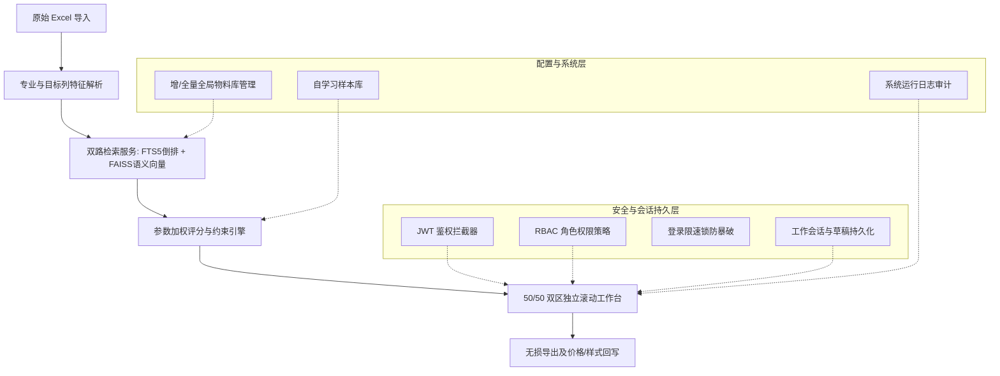

# 华康洁净物料清单匹配工具技术方案说明书 (V0.0.4)

本说明书详细阐述了华康洁净物料清单匹配工具的设计与技术方案。该工具作为通用的清单数据处理平台，旨在通过结构化参数解析、多路召回（FTS5全文倒排+语义向量搜索）、双轨制打分、前端可视化校对，将项目设计原始清单（包括暖通、电气、给排水专业）精准匹配至企业的标准物料库，并无损输出为符合规范的“标准格式”报表。

---

## 修订历史

| 版本号 | 修订日期 | 修订人 | 修订说明 |
|:---|:---|:---|:---|
| V0.0.1 | 2026-07-15 | 系统架构组 | 初始起草，定义核心多线程语义向量匹配及双路打分架构。 |
| V0.0.2 | 2026-07-16 | 系统开发组 | 添加 50/50 滚动工作台页面、物料库全/增量更新、免重启向量索引重建及日志控制台。 |
| V0.0.4 | 2026-07-18 | 开发二组 | **公网安全与数据持久化改造**：<br>1. 引入 JWT 状态管理与 Bearer Token 接口防御；<br>2. 建立 RBAC 角色体系（员工/经理/总监/管理员）与 UI 动态权限过滤；<br>3. 引入登录频次限制（5分钟失败5次锁号/IP 15分钟）与独立 `security.log` 安全日志审计；<br>4. 增加工作会话暂存机制：包含 3分钟静默草稿自动暂存（起步提示恢复）与多版本手动命名进度备份（支持覆盖更新）；<br>5. 优化推荐候选区交互：点击已激活卡片可直接无弹窗解绑；<br>6. 整理并精简了项目工程文档。 |

---

## 一、 业务流程比对：原始手工 vs. 智能工作流

| 环节 | 原始手工操作流程 | 本系统智能操作流程 |
| :--- | :--- | :--- |
| **第一步：上传读取** | 打开原始清单，人工分析确定专业、目标特征列。 | 上传原始 Excel，系统**自动识读专业类别**与特征列数据。 |
| **第二步：库内检索** | 根据规格文本，在系统库中手动做单关键词搜索，效率低下。 | **双路智能召回**（FTS5全文检索 + 语义向量相似度检索），毫秒级召回 Top 500 候选项。支持分号逗号多词联合搜索。 |
| **第三步：参数校对** | 人眼校对风量、功率、材质、芯数等参数，极易出错。 | 自动使用强鲁棒性正则**抽取结构化参数**，计算物理量偏离度得分，不符规格惩罚限制。 |
| **第四步：交互核对** | 线下反复核对，逐条输入产品项管信息或物料编码。 | **大宽屏 50/50 独立滚动工作台**，突出置信得分与参数对比。支持特征芯片（Chips）交互筛选、重匹配及一键批量套用。 |
| **第五步：表格回写** | 重新建表排版，人工誊抄数据，手动整理重排首列序号。 | **无损复刻样式样式与公式**，按需仅导出当次匹配内容，全局重排连续序号，自动回填历史价格。 |

---

## 二、 系统架构与关键技术

系统架构图如下所示：



### 1. 双路智能召回机制 (FTS5 + FAISS Vector Search)
为了兼顾“字面精确匹配”和“语义意图理解”，系统采用了**多路召回**架构：
* **FTS5 全文倒排索引召回**：利用 SQLite 内置的 FTS5 虚拟表，将物料名称、规格型号拆分后建立倒排索引，秒级匹配字面相同的项。
* **FAISS 语义向量召回**：利用 `sentence-transformers` 对物料池进行向量化编码。使用 `faiss.IndexFlatIP` 内积索引库在毫秒级内检索出语义最接近的 top 条目。
* **Numpy 余弦相似度降级保障**：在无二进制 FAISS 编译环境的场景下，系统无缝切换至纯 Numpy 矩阵向量余弦相似度计算，计算精度不发生任何衰减。
* **多词联合模糊搜索**：针对手动搜索场景，支持分号或逗号（如 `"配电柜；60KW"`）输入多个联合词，系统自动以 `AND` 逻辑多字段联合匹配。

### 2. 特征抽取与数据预处理
* **属性提取与单位清洗**：
  * 对规格/特征描述字段，智能解析带有冒号 `:` 的二级键值对（例如：`“送风量：5750m3/h”` 提取为 `送风量: 5750`）。
  * 自动剔除物理单位后缀（如 `m³/h`、`kW`、`Pa` 等），保证特征对比键名纯净一致。
  * 过滤忽略无价值、冗长干扰匹配的“`工作内容`”或“`调试`”字段。
* **电气多芯线缆专有参数捕获**：
  * 电气线缆自动提取规格中的**芯数**（如 `5`、`3+2`）以及**截面积**（如 `2.5`、`16+10`）。

### 3. 双轨加权评分算法
* **第一轨：高精度型号匹配**：若设备型号 100% 对准，置为完全精确对齐。
* **第二轨：参数加权打分**：
  * **文本相似度** (权重 30%)、**型号相似度** (权重 30%)、**参数偏离度** (权重 30%)。
  * **关键项冲突惩罚**：电缆芯数或面积不符扣 `30分`；管径 `DN` 不匹配扣 `20分`。
  * **匹配置信度加成 (Boost)** (权重 10%)：当核心参数无偏离完全匹配时，增加 `25分` 额外打分。

### 4. [NEW] 用户认证与 RBAC 权限体系 (V0.0.4)
为了适配公网部署并保障企业数据资产安全，系统设计了精细的认证鉴权机制：
* **用户认证**：采用密码盐哈希算法（`bcrypt`）在本地加密存储。基于 **JWT (JSON Web Token)** 进行状态管理，登录成功后签发 token，有效期 8 小时。
* **RBAC 角色划分**：
  * `employee` (员工)：可访问智能工作台（清单导入、匹配、手动修改、导出报表）。
  * `manager` (经理)：除工作台外，可**只读查看**系统配置规则词典，以及物料库版本和状态信息。
  * `director` (总监)：除经理权限外，有权在前端**更新、替换全局企业物料库**，以及查看系统运行日志。
  * `admin` (管理员)：完整权限，包括在页面上**增删改查系统账号**、**分配角色**及**修改核心系统参数配置**。
* **前端路由与 UI 渲染限制**：前端通过拦截器统一拦截 `fetch` 请求注入 token。若接口返回 `401` 则重定向至 `login.html`；同时前端根据当前用户角色动态隐藏无权查看的侧边栏、保存按钮、物料上传及管理后台入口。

### 5. [NEW] 工作进度暂存与多版本保存机制 (V0.0.4)
针对公网部署可能面临的网页刷新、断网或中途离开导致进度丢失的问题，本版本实现了完善的数据持久化：
* **静默草稿自动暂存 (Draft)**：用户处理清单时，前端每 3 分钟自动保存一次当前 items 快照至 `work_sessions` 数据库表。每个用户只保留最新一份草稿，保存期 30 天。下次登录系统且工作台为空时，会自动弹出弹窗，提示用户“是否一键载入上次意外中断的草稿进度”。
* **手动命名多版本备份 (Saved)**：用户点击【暂存进度】，输入项目或阶段名称，即可在数据库中持久化存档，支持无限份备份。点击【历史记录】可查看所有存档文件、最近编辑时间，一键载入恢复或永久删除。历史记录与账号物理隔离，互不干涉。

### 6. [NEW] 传输层加密与防暴力破解安全加固 (V0.0.4)
* **登录限速防御**：限制同一 IP 或同一用户名在 5 分钟内最多尝试 5 次登录，超过则自动锁定该 IP/用户名 15 分钟，防止暴力破解。所有安全事件（登录成功/失败、账号锁定、未授权接口尝试）详细记录至独立日志 `logs/security.log`。
* **安全响应头拦截**：FastAPI 配置自定义安全中间件，自动向所有前端请求注入 `X-Content-Type-Options: nosniff`、`X-Frame-Options: DENY` 及 `X-XSS-Protection: 1; mode=block`，防御点击劫持和 XSS 注入。

---

## 三、 功能模块设计

### 1. 50/50 独立滚动大屏工作台
* **左右大分栏**：
  * **左侧列表**：包含清单列表，状态灯指示匹配进度，顶部有快速过滤栏（全部、精确、待确认、未匹配）和联合查询。分页机制（每页 50 行）保证大文件渲染流畅。
  * **右侧分栏 (均分 50%)**：
    * **上半部分**：展示选中行的原始数据、物理量参数提取值、以及交互式 **参数 Chips 芯片**。用户可直接点击开启/关闭某个物理约束，或一键“批量套用”当前修正参数重算。
    * **下半部分**：展现智能检索 Top 3 候选物料（**点击已选中高亮卡片直接取消绑定**），以及手动全文联合查询区。

### 2. 全局物料库在线维护
* 操作员上传物料 Excel 后，支持 **全量覆盖** 与 **增量合并**。
* 重建逻辑：后台收到文件后，自动重写数据库，并触发 `index_manager` 实时热更新 FAISS 向量索引缓存，无需重启服务进程，物料检索立即生效。

### 3. 系统运行日志终端
* 后台详细记录系统错误和运行时间日志于 `logs/app_runtime.log`。
* 前端参数配置界面中包含专门的“系统日志 console 控制台”，只读角色也可以直接通过轮询实时查阅最新 logs 轨迹，追踪异常情况。

---

## 四、 物理结构与工程目录 (V0.0.4)

```
ListTrans/
├── app/
│   ├── __init__.py
│   ├── db_manager.py        # 数据库驱动、全/增量导入、多词检索
│   ├── preprocessor.py      # 表头提取、物理属性与单位清洗
│   ├── matcher.py           # 属性评分、线缆管径软硬约束扣分
│   ├── report_generator.py  # 样式复制、反填历史均价排版导出
│   ├── auth_manager.py      # 用户登录校验、bcrypt哈希、JWT签发与锁定限制
│   ├── auth_middleware.py   # FastAPI 鉴权拦截器与角色限制
│   ├── admin_api.py         # 管理员用户管理接口 (增删改查、改密码)
│   ├── session_manager.py   # 会话持久化、静默草稿与备份保存逻辑
│   └── server.py            # FastAPI Web 路由层与安全中间件
├── doc/
│   ├── technical_solution.md # [本文件] 升级版系统技术方案说明书
│   └── sample/
│       ├── 原始清单.xlsx     # 待匹配输入模板
│       ├── 标准格式.xlsx     # 报表导出样式与公式模板
│       └── 物料明细.xlsx     # 4.6万行全局企业物料源数据库
├── logs/
│   ├── app_runtime.log      # 系统运行业务日志
│   └── security.log         # 安全审计与登录爆破拦截日志
├── web/
│   ├── index.html           # 50/50大屏工作台主页面
│   ├── index.css            # 暗色系高档毛玻璃特效样式表
│   ├── app.js               # 带有中央 token 拦截器的交互核心
│   ├── login.html           # 玻璃拟态登录界面
│   ├── login.css            # 登录界面定制样式
│   ├── admin.html           # 用户管理与角色分配控制面板
│   └── logo500.png          # 企业品牌徽标
├── requirements.txt         # 生产依赖包声明文件
└── .env.example             # 部署环境变量模版
```

---

## 五、 核心 API 接口说明 (V0.0.4)

### 1. `POST /api/auth/login`
* **功能**：用户登录，签发 JWT 令牌。

### 2. `GET/POST/PUT/DELETE /api/admin/users`
* **功能**：[仅管理员] 增删改查系统内用户、更改角色、锁定状态及重置密码。

### 3. `POST /api/session/draft` & `GET /api/session/draft`
* **功能**：自动静默暂存与恢复草稿。

### 4. `POST /api/session/save` & `GET /api/session/list`
* **功能**：手动命名保存与读取历史进度记录。

### 5. `POST /api/upload`
* **功能**：[仅员工及以上] 上传原始清单 Excel，分析专业，批量重算推荐项。

### 6. `POST /api/export`
* **功能**：[仅员工及以上] 样式克隆反填，重编排连续序号，按需无损生成交付报表。

### 7. `GET /api/config/load` & `POST /api/config/save`
* **功能**：读取/保存规则词典配置（普通员工禁止操作）。
