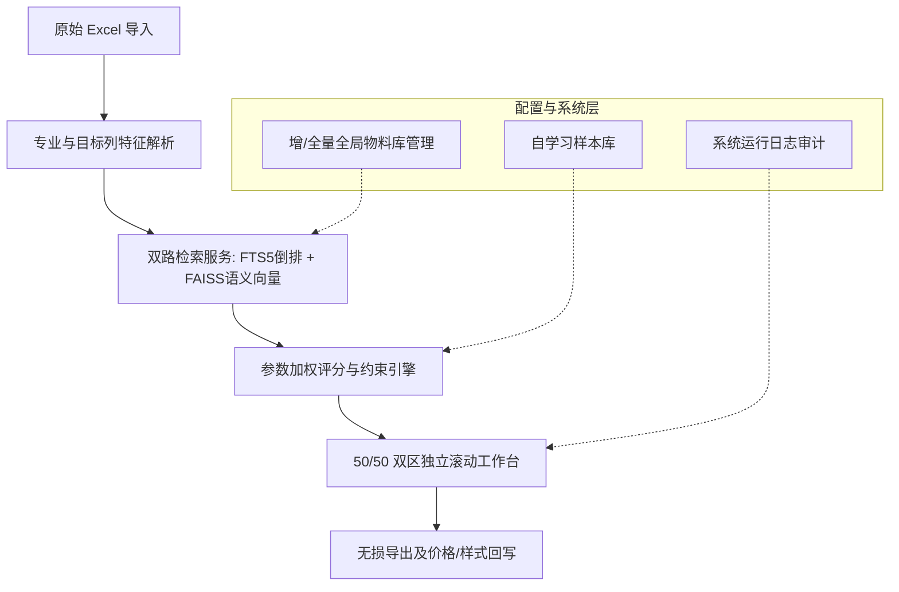

# 华康洁净物料清单匹配工具技术方案说明书 (V0.0.2)

本说明书详细阐述了华康洁净物料清单匹配工具的设计与技术方案。该工具作为通用的清单数据处理平台，旨在通过结构化参数解析、多路召回（FTS5全文倒排+语义向量搜索）、双轨制打分、前端可视化校对，将项目设计原始清单（包括暖通、电气、给排水专业）精准匹配至企业的标准物料库，并无损输出为符合规范的“标准格式”报表。

---

## 一、 业务流程比对：原始手工 vs. 智能工作流

| 环节 | 原始手工操作流程 | 本系统智能操作流程 |
| :--- | :--- | :--- |
| **第一步：上传读取** | 打开原始清单，人工分析确定专业、目标特征列。 | 上传原始 Excel，系统**自动识读专业类别**与特征列数据。 |
| **第二步：库内检索** | 根据规格文本，在系统库中手动做单关键词搜索，效率低下。 | **双路智能召回**（FTS5全文检索 + 语义向量相似度检索），毫秒级召回 Top 500 候选项。支持分号逗号多词联合搜索。 |
| **第三步：参数校对** | 人眼校对风量、功率、材质、芯数等参数，极易出错。 | 自动使用强鲁棒性正则**抽取结构化参数**，计算物理量偏离度得分，不符规格惩罚限制。 |
| **第四步：交互核对** | 线下反复核对，逐条输入产品项管信息或物料编码。 | **大宽屏 50/50 独立滚动工作台**，突出置信得分与参数对比。支持特征芯片（Chips）交互筛选、重匹配及一键批量套用。 |
| **第五步：表格回写** | 重新建表排版，人工誊抄数据，手动整理重排首列序号。 | **无损复刻样式样式与公式**，按需仅导出当次匹配内容，全局重排连续序号，自动回填历史价格。 |

---

## 二、 系统架构与关键技术

系统架构图如下所示：



### 1. 双路智能召回机制 (FTS5 + FAISS Vector Search)
为了兼顾“字面精确匹配”和“语义意图理解”，系统采用了**多路召回**架构：
* **FTS5 全文倒排索引召回**（占比 15%）：利用 SQLite 内置的 FTS5 虚拟表，将物料名称、规格型号拆分为单字符倒排索引，秒级匹配字面相同的项。
* **FAISS 语义向量召回**（占比 85%）：利用 `sentence-transformers`（默认使用 `paraphrase-multilingual-MiniLM-L12-v2` 384维多语言轻量模型）对物料池进行向量化编码。使用 `faiss.IndexFlatIP` 内积索引库在毫秒级内检索出语义最接近的 top 条目。
* **Numpy 余弦相似度降级保障**：在无二进制 FAISS 编译环境或服务器脱网降级运行的场景下，系统无缝切换至纯 Numpy 矩阵向量余弦相似度计算，计算精度不发生任何衰减。
* **联合多词联合模糊搜索**：针对全局搜索场景，用户可用分号或逗号（如 `"配电柜；60KW"`）输入多个联合词。系统自动分割出子项词，并使用 `AND` 逻辑生成 FTS/LIKE 多参数联查语句，确保多关键字交叉精确匹配。

### 2. 特征抽取与数据预处理
* **一级表头识别**：基于 `r'(?:\b|\n|^)(\d+)\s*[\.．、\s]\s*([^：:，,；;\n\r]{1,15})\s*[:：]'` 规则智能解析类似 `1.名称`、`2.规格` 的行前缀。
* **二级属性提取与单位清洗**：
  * 对规格/特征描述字段，智能解析带有冒号 `:` 的二级键值对（例如：`“送风量：5750m3/h”` 提取为 `送风量: 5750`）。
  * 自动剔除提取键名中的物理单位后缀（如 `m³/h`、`kW`、`Pa` 等），保证特征对比键名纯净一致。
  * 对没有冒号的非数值特征（例如 `“六管制，变频电机”`），自动提取为布尔值标记（即 `{"六管制": "六管制", "变频电机": "变频电机"}`）。
  * 过滤忽略无价值、冗长干扰匹配的“`工作内容`”或“`调试`”字段。
* **电气多芯线缆专有参数捕获**：
  * 电气材质/线缆自动提取规格中的**芯数**（如 `5`、`3+2`）以及 **截面积**（如 `2.5`、`16+10`）。

### 3. 双轨加权评分算法
系统针对召回的物料候选运行精确的比对排序：
* **第一轨：高精度型号匹配**：若设备型号 100% 对准，置为完全精确对齐。
* **第二轨：参数加权打分**：
  * **文本相似度 ($S_{\text{text}}$ - 权重 30%)**：计算物料分类与名称清洗后的重合度。
  * **型号匹配度 ($S_{\text{model}}$ - 权重 30%)**：计算规格型号字符串的相似率。
  * **参数偏离度 ($S_{\text{attrs}}$ - 权重 30%)**：对提取的核心物理参数（如风量、功率、管径等），通过相对偏离率计算数值相似度得分：
    $$S_{\text{attr}} = 1.0 - \frac{|V_{\text{query}} - V_{\text{candidate}}|}{\max(V_{\text{query}}, V_{\text{candidate}})}$$
  * **关键项强约束与硬核冲突惩罚**：
    * **电缆冲突惩罚**：若线缆的**芯数**或**截面积**与标准库候选数据不一致，直接重扣 `30分` 罚值，杜绝乱推荐异形规格。
    * **管径冲突惩罚**：若管线 `DN` 规格不匹配，重扣 `20分`。
  * **匹配置信度加成 (Boost - 权重 10%)**：当核心参数偏离率 100% 完全匹配时，自动增加 `25分` 额外权重，确立推荐地位。

---

## 三、 功能模块设计

### 1. 50/50 独立滚动大屏工作台
* **右侧分栏优化**：将右侧“智能匹配分析与校对”面板分为上下两半，每一半高度严格均分 **50%**，防止互相挤压。
  * **上半部分**：固定当前选中项的原始清单数据。支持交互式**特征维度标签（Chips）**。用户可点击任意标签激活/禁用其作为重新匹配的物理约束；同时支持“一键批量应用到同类设备”逻辑，利用线程池在后台并行重算相同名字的设备匹配。
  * **下半部分**：独立滚动的匹配决策卡片、Top 3 候选物料及手动全局检索区域。
* **左侧列表状态指示灯**：三色可视化看板（绿色已确认/Score $\ge 85$；黄色待校对/$40 \le \text{Score} < 85$；红色未匹配/Score $< 40$）。

### 2. 全局物料库在线维护
* **全量与增量上传管理**：
  * 支持操作员在前端系统配置菜单中直观上传 Excel 格式的物料数据库。
  * 提供 **全量替换（删除旧表重新导入）** 与 **增量添加（对于已存在编码进行覆盖，新物料执行合并添加）** 的写入策略。
* **元数据指标追踪**：系统自动记录物料库统计，显示在物料管理看板上（包含当前物料行数、上次上传时间、最近导入的文件名称）。
* **免重启向量重建**：每次数据导入成功后，后台会自动触发 `index_manager` 重建 FAISS / Numpy 向量索引，新添加的物料语义搜索一秒生效。

### 3. 系统运行日志与审计
* 在后台配置 `logging` 日志归档，将每次文件上传、搜索条件、导出报表、数据库重算等关键路径的信息实时记录至本地的 `logs/app_runtime.log`。
* 前端配置面板集成了**“系统运行日志”终端文本框**，以 `3秒` 间隔自动滚动载入最新 100 行日志记录，保障系统的健康度运行透明度。

### 4. 样式保留型模板回写导出
* **按需纯净导出**：仅导出当次上传清单匹配的物料条目。在回写前自动清空第 3 行及之后的多余历史数据。
* **样式与公式深度克隆**：利用 openpyxl 逐个克隆字体、填充、边框、单元格对齐和数字格式，完美重现交付规格。
* **自动重构序号**：重新拼接行数据后，对 A列 `*序号` 连续化全局重编号（1.1, 1.2, 1.3...）。
* **历史成交单价反填**：建立 `物料编码 -> 单价(无税)` 的映射反填缓存，保持价格一致性。

---

## 四、 物理结构与工程目录

```
ListTrans/
├── app/
│   ├── __init__.py
│   ├── db_manager.py        # 数据库驱动、全/增量导入、元数据查询与多词检索 API
│   ├── preprocessor.py      # 一级表头特征提取、忽略工作内容、单位过滤、布尔属性提取逻辑
│   ├── matcher.py           # 型号比对、参数偏离打分计算与线缆管径强冲突惩罚限制
│   ├── report_generator.py  # 克隆模板样式、反填价格、自动排版连续序号导出模块
│   └── server.py            # FastAPI Web 服务、后台日志归档系统与 API 路由层
├── doc/
│   ├── technical_solution.md # [本文件] 升级版系统技术方案说明书
│   └── sample/
│       ├── 原始清单.xlsx     # 待转换输入模板
│       ├── 标准格式.xlsx     # 导出报表样式与公式模板
│       └── 物料明细.xlsx     # 全局全局企业物料源数据库 (4.6万行)
├── logs/
│   └── app_runtime.log      # 系统运行日志归档文件
├── web/
│   ├── index.html           # 工作台大屏、参数 Chips 交互与配置控制端 HTML
│   ├── index.css            # 50/50 独立滚动面板布局、暗黑系毛玻璃特效 CSS
│   └── app.js               # 联合检索、DB 上传提交、日志自动刷新与组件渲染交互
└── tests/
    └── integration_test.py  # 涵盖特征提取、线缆打分、无冒号提取、多词搜索的9项自动化单元测试
```

---

## 五、 核心 API 接口说明

### 1. `POST /api/upload`
* **功能**：上传原始清单 Excel，分析专业，批量重算推荐项。
* **响应**：
  ```json
  {
    "items": [
      {
        "original_row_idx": 3,
        "original_name": "电力电缆",
        "original_spec": "1.型号: WDZ-YJY-5*2.5mm2",
        "is_exact": false,
        "matched_code": "EL-002",
        "matched_name": "铜芯电缆 WDZ-YJY 5*2.5",
        "professional": "电气",
        "parsed_spec": {
          "model": "WDZ-YJY-5*2.5mm2",
          "attrs": { "芯数": "5", "截面积": "2.5" }
        },
        "top_candidates": [ ... ]
      }
    ]
  }
  ```

### 2. `POST /api/match`
* **功能**：结合前端交互传入的指定特征参数子集（Chips 过滤后）单独执行重算。

### 3. `GET /api/search`
* **功能**：全局物料库检索。支持空格/分号/逗号多词联合模糊搜索。

### 4. `GET /api/db/metadata`
* **功能**：获取全局物料库当前指标（总行数、最后更新日期、历史文件名）。

### 5. `POST /api/db/upload`
* **功能**：上传新物料库 Excel 并执行增量/全量替换合并。更新元信息，实时重新训练 FAISS 向量索引缓存。

### 6. `GET /api/logs`
* **功能**：拉取最新的运行日志供控制台窗口自动滚动展现。

---

## 六、 流程与时序关系

```javascript
// 数据流转核心链路
[用户上传Excel] 
       │
       ▼
[server.py] ──提取专业──> [preprocessor.py] (智能分词, 二级参数与布尔属性抽取)
       │
       ▼
[db_manager.py] <──双路检索──> [SQLite FTS5 倒排] + [FAISS 语义相似度向量]
       │
       ▼
[matcher.py] (进行属性对齐评分, 执行线缆/管径冲突校验扣分)
       │
       ▼
[前端 UI app.js] (50/50 独立滚动渲染, 用户操作 Chips 二次微调重算)
       │
       ▼
[report_generator.py] (清空第三行以下旧行, 反填成交历史均价, 全局重算排版 1.x 序号导出)
```

本系统通过极致简练的 Vanilla 技术堆栈配合轻量化的多路打分策略，为企业清单的标准化对齐转换提供了无侵入、高可用、可在线热升级维护的微服务生产级解决方案。
