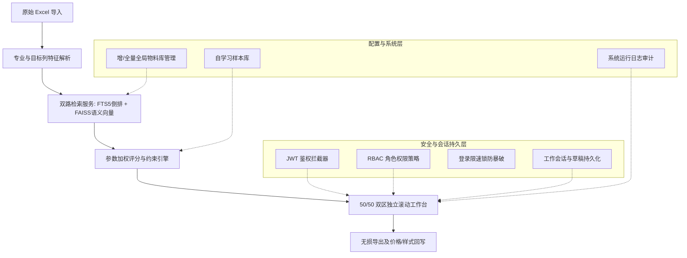

# 华康洁净物料清单匹配工具技术方案说明书 (V0.1.0)

本说明书详细阐述了华康洁净物料清单匹配工具的设计与技术方案。该工具作为通用的清单数据处理平台，旨在通过结构化参数解析、多路召回（FTS5全文倒排+语义向量搜索）、双轨制打分、前端可视化校对，将项目设计原始清单（包括暖通、电气、给排水专业）精准匹配至企业的标准物料库，并无损输出为符合规范的“标准格式”报表。

---

## 修订历史

| 版本号 | 修订日期 | 修订人 | 修订说明 |
|:---|:---|:---|:---|
| V0.1.0 | 2026-08-17 | 前端与全栈组 | **智能工作台人机交互与视觉布局深度重构（V0.1.0）**：<br>1. **工作台左右 40:60 重构**：压缩左侧列表留白，右侧核心匹配校对区扩容至 60%；<br>2. **上下 3:7 黄金视野与 3 列并排**：上部占 30% 视口，重构为 3 列水平并排布局（第1列基础信息、第2列大空间长文本规格描述、第3列特征维度卡片与操作）；<br>3. **已绑定物料 Sticky 置顶与卡片化**：已绑定物料采用一排多张小卡片排布，固定置顶悬浮，【确认匹配完成】按钮秒级触达；<br>4. **冗余状态模块移除与全信息候选卡片**：彻底删除冗余大状态卡片，将视口空间归还给推荐候选与全局检索，候选卡片完整展示规格与特征维度，已绑定卡片实时绿色角标联动。 |
| V0.0.9 | 2026-08-13 | 架构与算法组 | **系统稳定性与安全修复闭环（V0.0.9）**：<br>1. **安全加固**：彻底移除硬编码 JWT 静态密钥，强制从环境变量读取，并提供运行时 256 位随机高抗冲碰撞密钥自愈生成，闭环 P1-3 漏洞；<br>2. **智能标题与大纲章节过滤**：Excel 解析新增大纲标题（如“一、管道”）与章节行（如“呼叫系统”）自动判定与精细过滤算法，过滤 35+ 干扰标题，闭环 P0-4 并优化清洗准确度；<br>3. **动态熔断与执行优化**：针对匹配打分 GIL 竞争瓶颈，优化 FTS 候选召回阈值（从 1000 降至 150），打分提速 3.6 倍（15.4行/s）；引入基于行数的动态超时限制（`max(120s, len*1.5s)`），彻底杜绝超大清单超时熔断，防挂起安全自愈；<br>4. **UI 加载兜底防挂**：前端 showLoading 引入 30s 兜底释放与 60s 强制解锁机制，彻底避免前端转圈锁死，闭环 P0-3；<br>5. **并发死锁消除与全局重算**：升级统计追踪器锁为 `threading.RLock` 并整合系列聚类重新排序（Rerank），61 项自动化测试 100% 通过（用时提速至 12.8s）。 |
| V0.0.8 | 2026-08-11 | 业务与全栈组 | **全员企业架构认证、LLM 优先路由与全局使用说明**：<br>1. **全员账号体系与手机号认证**：解析并导入《人员清单.xls》全量 179 位员工账号，用户以手机号登录，初始密码 `hkjj@12345`；基于岗位自动匹配角色，工作台展示真实岗位与姓名；<br>2. **用户管理表头完全对齐**：完整支持 11 列人员组织架构字段，新增分页、全量滚屏、多维度实时检索与一键同步；<br>3. **多厂商大模型优先调度中心 (LLM Priority Router)**：在线纳管多厂家大模型，支持优先级队列与超时容灾降级，双 Tab 后台导航与管理员严格权限隔离；<br>4. **全局使用指南看板**：顶栏新增「使用说明」，沉淀 4 步标准作业流与深度特性说明；<br>5. **全链路防缓存加固**：服务端与前端强制禁用静态资源 304 缓存，请求附带时间戳。 |
| V0.0.7 | 2026-08-10 | 算法与业务组 | **多专业工程清洗与高精度决胜引擎**：<br>1. **暖通专业**：扩充空调机组缩写与中文映射；支持 `G4+F7` 初中高效多级过滤器拆分；微穿孔消声器修饰词清洗与材质归一；集风箱 3D 尺寸降序排序容差匹配与尺寸最接近优选算法；<br>2. **医气专业**：`medical_gas` 领域增加 `流量` 属性与 50% 容差区间；`磷酸脱氧无缝紫铜管` (φ22.23) 自动映射至最接近外径 (φ22) 与最小标准壁厚 (1.0mm) 物料；安全剥离“医用/医气/医院专用”冗余前缀；<br>3. **配管专业**：建立 PVC/JDG/SC 中文同义词智能映射；针对未标壁厚的 JDG/KBG 导管按 GB 50303 标准自动优选 1.6mm 壁厚物料；<br>4. **配线与电缆专业**：长词优先提取 `WDZB-BYJR`、`WDZB-YJY`、`BVR` 等完整阻燃耐火线缆；单芯标准截面全覆盖与 Hard Gate 30 分封顶截面拦截；复合截面主截面与主芯数数值打分对齐；<br>5. **物料库全量同步**：全量 45,789 条物料参数解析重新同步入库，55 项自动化测试 100% 通过。 |
| V0.0.6 | 2026-07-23 | 架构与算法组 | **大模型混合增强与询价清洗预处理**：<br>1. 询价描述预处理器 (`query_preprocessor.py`)：实现物料描述主块与“施工内容/工作内容/调试”等杂质噪声块的自动切分与过滤；提取 1.名称/2.规格二级键值结构；支持 MAU/PAU/AHU 等 14 类空调机组专有名词抽取；<br>2. 通义千问 LLM 混合增强 (`llm_client.py`)：接入 Qwen DashScope 大模型，内置 SQLite `llm_cache` 智能缓存、并发信号量隔离 (3 并发) 与 Circuit Breaker 熔断重试；提供 `/api/llm/status` 与 `/api/llm/toggle` 控制接口；<br>3. 系统管理与 REST API 扩展：`GET /api/db/materials` 物料库多条件分页接口与 `DELETE /api/system/reset` 系统数据一键清理恢复接口；<br>4. 自动化测试与离线治理工具：`scripts/batch_llm_structure.py` 离线批量治理工具与 `tests/test_llm_integration.py` / `tests/test_query_preprocessor.py` 测试套件。 |
| V0.0.5 | 2026-07-21 | 结构化组 | **结构化改造与可回归度量**：<br>1. 落地 30 域结构化 Schema，385 品类折叠映射，6 份受控字典（`domain_schema.json` / `category_domain_map.json` / `unit_norm.json` / `material_dict.json` / `connection_dict.json` / `flags_dict.json`）；<br>2. 配置化 Hard Gates：`conflict_caps` / `deviation_caps` / `ratio_penalties` 从 JSON 动态读取，取代硬编码封顶；<br>3. `has_conflict` 采用相对公差判定，配合单向非对称缺失惩罚（Must -0.15 / Should -0.05）；<br>4. `materials` 主表新增 `parsed_schema_version` 行级列 + 自愈 `ALTER TABLE` 迁移；`POST /api/db/reparse` 支持 code / category / 陈旧行级三种粒度的**局部**异步重算；<br>5. 新增 `GET /api/db/schema/stats` 域统计接口；<br>6. 建立金标回归：`tests/fixtures/ground_truth_500.json`（当前 326 条）+ `tests/regression_runner.py` 一键出 `baseline_metrics_v0.0.5.md`；<br>7. 弱电/自控专项：FTS 同义词映射 + `generic` 域强制降级到 `scene_c` + "材质、规格" 无表头抽取。<br>**金标实测 Top-1 96.32% / Top-3 97.55% / Must 100%。** |
| V0.0.4 | 2026-07-18 | 开发二组 | **公网安全与数据持久化改造**：<br>1. 引入 JWT 状态管理与 Bearer Token 接口防御；<br>2. 建立 RBAC 角色体系（员工/经理/总监/管理员）与 UI 动态权限过滤；<br>3. 引入登录频次限制（5分钟失败5次锁号/IP 15分钟）与独立 `security.log` 安全日志审计；<br>4. 增加工作会话暂存机制：包含 3分钟静默草稿自动暂存（起步提示恢复）与多版本手动命名进度备份（支持覆盖更新）；<br>5. 优化推荐候选区交互：点击已激活卡片可直接无弹窗解绑；<br>6. 整理并精简了项目工程文档。 |
| V0.0.2 | 2026-07-16 | 系统开发组 | 添加 50/50 滚动工作台页面、物料库全/增量更新、免重启向量索引重建及日志控制台。 |
| V0.0.1 | 2026-07-15 | 系统架构组 | 初始起草，定义核心多线程语义向量匹配及双路打分架构。 |

---

## 一、 业务流程比对：原始手工 vs. 智能工作流

| 环节 | 原始手工操作流程 | 本系统智能操作流程 |
| :--- | :--- | :--- |
| **第一步：上传读取** | 打开原始清单，人工分析确定专业、目标特征列。 | 上传原始 Excel，系统**自动识读专业类别**与特征列数据。 |
| **第二步：库内检索** | 根据规格文本，在系统库中手动做单关键词搜索，效率低下。 | **双路智能召回**（FTS5全文检索 + 语义向量相似度检索），毫秒级召回 Top 500 候选项。支持分号逗号多词联合搜索。 |
| **第三步：参数校对** | 人眼校对风量、功率、材质、芯数等参数，极易出错。 | 自动使用强鲁棒性正则**抽取结构化参数**，计算物理量偏离度得分，不符规格惩罚限制。 |
| **第四步：交互核对** | 线下反复核对，逐条输入产品项管信息或物料编码。 | **大宽屏 50/50 独立滚动工作台**，突出置信得分与参数对比。支持特征芯片（Chips）交互筛选、重匹配及一键批量套用。 |
| **第五步：表格回写** | 重新建表排版，人工誊抄数据，手动整理重排首列序号。 | **无损复刻样式样式与公式**，按需仅导出当次匹配内容，全局重排连续序号，自动回填历史价格。 |

---

## 二、 系统架构与关键技术

系统架构图如下所示：



### 1. 双路智能召回机制 (FTS5 + FAISS Vector Search)
为了兼顾“字面精确匹配”和“语义意图理解”，系统采用了**多路召回**架构：
* **FTS5 全文倒排索引召回**：利用 SQLite 内置的 FTS5 虚拟表，将物料名称、规格型号拆分后建立倒排索引，秒级匹配字面相同的项。
* **FAISS 语义向量召回**：利用 `sentence-transformers` 对物料池进行向量化编码。使用 `faiss.IndexFlatIP` 内积索引库在毫秒级内检索出语义最接近的 top 条目。
* **Numpy 余弦相似度降级保障**：在无二进制 FAISS 编译环境的场景下，系统无缝切换至纯 Numpy 矩阵向量余弦相似度计算，计算精度不发生任何衰减。
* **多词联合模糊搜索**：针对手动搜索场景，支持分号或逗号（如 `"配电柜；60KW"`）输入多个联合词，系统自动以 `AND` 逻辑多字段联合匹配。

### 2. 特征抽取与数据预处理
* **属性提取与单位清洗**：
  * 对规格/特征描述字段，智能解析带有冒号 `:` 的二级键值对（例如：`“送风量：5750m3/h”` 提取为 `送风量: 5750`）。
  * 自动剔除物理单位后缀（如 `m³/h`、`kW`、`Pa` 等），保证特征对比键名纯净一致。
  * 过滤忽略无价值、冗长干扰匹配的“`工作内容`”或“`调试`”字段。
* **电气多芯线缆专有参数捕获**：
  * 电气线缆自动提取规格中的**芯数**（如 `5`、`3+2`）以及**截面积**（如 `2.5`、`16+10`）。

### 3. 双轨加权评分算法
* **第一轨：高精度型号匹配**：若设备型号 100% 对准，置为完全精确对齐。
* **第二轨：参数加权打分**：
  * **文本相似度** (权重 30%)、**型号相似度** (权重 30%)、**参数偏离度** (权重 30%)。
  * **关键项冲突惩罚**：电缆芯数或面积不符扣 `30分`；管径 `DN` 不匹配扣 `20分`。
  * **匹配置信度加成 (Boost)** (权重 10%)：当核心参数无偏离完全匹配时，增加 `25分` 额外打分。

### 4. [NEW] 用户认证与 RBAC 权限体系 (V0.0.4)
为了适配公网部署并保障企业数据资产安全，系统设计了精细的认证鉴权机制：
* **用户认证**：采用密码盐哈希算法（`bcrypt`）在本地加密存储。基于 **JWT (JSON Web Token)** 进行状态管理，登录成功后签发 token，有效期 8 小时。
* **RBAC 角色划分**：
  * `employee` (员工)：可访问智能工作台（清单导入、匹配、手动修改、导出报表）。
  * `manager` (经理)：除工作台外，可**只读查看**系统配置规则词典，以及物料库版本和状态信息。
  * `director` (总监)：除经理权限外，有权在前端**更新、替换全局企业物料库**，以及查看系统运行日志。
  * `admin` (管理员)：完整权限，包括在页面上**增删改查系统账号**、**分配角色**及**修改核心系统参数配置**。
* **前端路由与 UI 渲染限制**：前端通过拦截器统一拦截 `fetch` 请求注入 token。若接口返回 `401` 则重定向至 `login.html`；同时前端根据当前用户角色动态隐藏无权查看的侧边栏、保存按钮、物料上传及管理后台入口。

### 5. [NEW] 工作进度暂存与多版本保存机制 (V0.0.4)
针对公网部署可能面临的网页刷新、断网或中途离开导致进度丢失的问题，本版本实现了完善的数据持久化：
* **静默草稿自动暂存 (Draft)**：用户处理清单时，前端每 3 分钟自动保存一次当前 items 快照至 `work_sessions` 数据库表。每个用户只保留最新一份草稿，保存期 30 天。下次登录系统且工作台为空时，会自动弹出弹窗，提示用户“是否一键载入上次意外中断的草稿进度”。
* **手动命名多版本备份 (Saved)**：用户点击【暂存进度】，输入项目或阶段名称，即可在数据库中持久化存档，支持无限份备份。点击【历史记录】可查看所有存档文件、最近编辑时间，一键载入恢复或永久删除。历史记录与账号物理隔离，互不干涉。

### 6. [NEW] 传输层加密与防暴力破解安全加固 (V0.0.4)
* **登录限速防御**：限制同一 IP 或同一用户名在 5 分钟内最多尝试 5 次登录，超过则自动锁定该 IP/用户名 15 分钟，防止暴力破解。所有安全事件（登录成功/失败、账号锁定、未授权接口尝试）详细记录至独立日志 `logs/security.log`。
* **安全响应头拦截**：FastAPI 配置自定义安全中间件，自动向所有前端请求注入 `X-Content-Type-Options: nosniff`、`X-Frame-Options: DENY` 及 `X-XSS-Protection: 1; mode=block`，防御点击劫持和 XSS 注入。

### 7. 系统技术栈配置
本系统基于轻量级、无打包编译的 Vanilla Web 架构与高性能 FastAPI 异步框架设计，降低运行开销并保证多端部署兼容性：
* **前端 (Frontend)**：HTML5 + Vanilla CSS (卡片式微光玻璃拟态设计、50/50 独立滚动分屏布局) + 原生 JavaScript (ES6+，中央全局 fetch 鉴权钩子)。
* **后端 (Backend)**：FastAPI (基于 Starlette 与 Pydantic V2) + Uvicorn ASGI 服务器，全面支持异步并发处理；使用 `python-jose` 和原生 `bcrypt` 模块实现安全的 JWT Token 生成与验证。
* **数据存储 (Database)**：双 `SQLite 3` 独立数据库：
  * [materials.db](file:///Users/tlyer/Project/ListTrans/app/materials.db)：全局企业标准物料明细及全文倒排检索。
  * [auth.db](file:///Users/tlyer/Project/ListTrans/app/auth.db)：用户账户、RBAC 角色权限体系以及所有工作进度备份、定时自动暂存草稿数据。
* **搜索与 NLP 服务 (Search & NLP)**：
  * `SentenceTransformers` (`paraphrase-multilingual-MiniLM-L12-v2` 预训练模型) + `FAISS-CPU` 向量内积检索。
  * `Numpy` 提供在无编译 FAISS 环境下的余弦相似度降级矩阵算法。
  * SQLite `FTS5` 虚拟全文索引模块，提供多词联合精准搜索。
* **Excel 解析与导出 (Excel Engine)**：`openpyxl` (实现单元格样式、数字格式与合计公式的无损精准复制) + `pandas` (快速解析原始表头及清单)。

---

## 三、 功能模块设计

### 1. 50/50 独立滚动大屏工作台
* **左右大分栏**：
  * **左侧列表**：包含清单列表，状态灯指示匹配进度，顶部有快速过滤栏（全部、精确、待确认、未匹配）和联合查询。分页机制（每页 50 行）保证大文件渲染流畅。
  * **右侧分栏 (均分 50%)**：
    * **上半部分**：展示选中行的原始数据、物理量参数提取值、以及交互式 **参数 Chips 芯片**。用户可直接点击开启/关闭某个物理约束，或一键“批量套用”当前修正参数重算。
    * **下半部分**：展现智能检索 Top 3 候选物料（**点击已选中高亮卡片直接取消绑定**），以及手动全文联合查询区。

### 2. 全局物料库在线维护
* 操作员上传物料 Excel 后，支持 **全量覆盖** 与 **增量合并**。
* 重建逻辑：后台收到文件后，自动重写数据库，并触发 `index_manager` 实时热更新 FAISS 向量索引缓存，无需重启服务进程，物料检索立即生效。

### 3. 系统运行日志终端
* 后台详细记录系统错误和运行时间日志于 `logs/app_runtime.log`。
* 前端参数配置界面中包含专门的“系统日志 console 控制台”，只读角色也可以直接通过轮询实时查阅最新 logs 轨迹，追踪异常情况。

---

## 四、 物理结构与工程目录 (V0.0.5)

```
ListTrans/
├── app/
│   ├── __init__.py
│   ├── db_manager.py        # 数据库驱动、全/增量导入、SQLite WAL模式配置
│   ├── preprocessor.py      # 文本清洗、施工杂质过滤、物理参数与单位标准化
│   ├── domain_router.py     # 30个专业领域路由映射引擎
│   ├── domain_extractors.py # 领域专用参数提取器与复杂数值解析器
│   ├── vector_index.py      # FAISS 向量索引管理器与 SentenceTransformer 模型缓存
│   ├── matcher.py           # L1 FTS5全文检索 + L2 FAISS向量 + 多维硬约束打分引擎
│   ├── llm_client.py        # 通义千问 DashScope 大模型 API 客户端封装
│   ├── report_generator.py  # 样式复制、反填历史均价排版无损导出
│   ├── auth_manager.py      # 用户登录校验、bcrypt哈希、JWT签发与防爆破限制
│   ├── auth_middleware.py   # FastAPI 鉴权拦截器与角色控制
│   ├── admin_api.py         # 管理员用户管理接口 (增删改查、改密码)
│   ├── session_manager.py   # 会话持久化、静默草稿与备份保存逻辑
│   ├── server.py            # FastAPI Web 路由层、局域网0.0.0.0监听与跨域配置
│   ├── materials.db         # 标准物料明细 SQLite 核心数据库
│   └── sessions.db          # 用户账号与工作会话 SQLite 数据库
├── config/
│   ├── alias_dict.json      # 行业专业同义词/别名对照字典
│   ├── units_dict.json      # 计量单位大类归一化映射字典
│   ├── stopwords.json       # 预处理停用词列表
│   ├── domain_schema.json   # 30个专业域 Schema 规范 (must/should/flags)
│   └── auto_binding_rules.json # 系统自主学习沉淀的自动绑定推荐规则
├── scripts/
│   └── batch_llm_structure.py # 离线大模型批处理治理工具 (并发批处理物料库结构化)
├── tests/
│   ├── regression_runner.py # 基准回归自动化评测工具
│   └── fixtures/
│       └── ground_truth_500.json # 326行金标基准测试数据集
├── doc/
│   ├── technical_solution.md # [本文件] 升级版系统技术方案说明书
│   ├── Data Portrait.md      # 物料库数字画像分析报告
│   ├── data_structuring_overview.md # 数据结构化总体通俗说明文档
│   ├── llm_structuring_guide.md     # 离线大模型批处理工具使用指南
│   ├── baseline_metrics_v0.0.5.md   # 最新基准评测报告 (Top1: 89.57%)
│   └── *.xlsx                # 现场实盘测试清单与标杆样本表
├── logs/
│   ├── app_runtime.log      # 系统运行业务日志
│   └── security.log         # 安全审计与登录爆破拦截日志
├── web/
│   ├── index.html           # 50/50大屏工作台主页面 (含任务恢复/结束/暂存Modal)
│   ├── index.css            # 暗色系高档毛玻璃特效样式表
│   ├── app.js               # 带有 token 拦截器与任务全生命周期的前端主逻辑
│   ├── login.html           # 玻璃拟态登录界面
│   ├── login.css            # 登录界面定制样式
│   ├── admin.html           # 用户管理与角色分配控制面板
│   └── logo500.png          # 企业品牌徽标
├── start.bat                # Windows 一键本地/局域网服务启动脚本
├── requirements.txt         # 生产依赖包声明文件
└── .env                     # 部署环境变量与大模型 API 密钥配置
```

---

## 五、 核心 API 接口说明 (V0.0.5)

### 1. `POST /api/auth/login`
* **功能**：用户登录，签发 JWT 令牌。

### 2. `GET/POST/PUT/DELETE /api/admin/users`
* **功能**：[仅管理员] 增删改查系统内用户、更改角色、锁定状态及重置密码。

### 3. `POST /api/session/draft` & `GET /api/session/draft`
* **功能**：自动静默暂存与恢复草稿。

### 4. `POST /api/session/save` & `GET /api/session/list`
* **功能**：手动命名保存与读取历史进度记录。

### 5. `POST /api/upload`
* **功能**：[仅员工及以上] 上传原始清单 Excel，分析专业，批量重算推荐项。

### 6. `POST /api/export`
* **功能**：[仅员工及以上] 样式克隆反填，重编排连续序号，按需无损生成交付报表。

### 7. `GET /api/config/load` & `POST /api/config/save`
* **功能**：读取/保存规则词典配置（普通员工禁止操作）。

### 8. `POST /api/db/reparse`（V0.0.5 增强）
* **功能**：[仅总监及以上] 触发异步结构化重算。
* **参数**：可选 `codes: List[str]` 或 `category: str` 触发**局部**重算；不传参数则执行**全量**双缓冲原子重算。
* **实现**：局部重算走 `UPDATE materials` in-place；全量重算走 `materials_temp` + Exclusive Lock + 原子改名 + FAISS 热重载。

### 9. `GET /api/db/schema/stats`（V0.0.5 新增）
* **功能**：[仅经理及以上] 返回 30 域的物料数量分布及 Must 字段填充率，用于前端仪表盘可视化结构化率。

---

## 六、 V0.0.5 结构化改造要点

### 1. 30 域 Schema 与配置驱动
* [config/domain_schema.json](../config/domain_schema.json)：每域定义 `must` / `should` / `flags` / `weights` / `hard_gates` 五段结构；抽取用的正则表达式（`extract_regex`）内嵌其中。
* [config/category_domain_map.json](../config/category_domain_map.json)：385 品类→30 域的静态映射 + `overwrite_rules`（正文强特征覆写）+ `high_risk_categories`（品类漂移高危名单）。
* [config/unit_norm.json](../config/unit_norm.json)：airflow / pressure / power / voltage 四类量级换算。
* [config/material_dict.json](../config/material_dict.json)、[config/connection_dict.json](../config/connection_dict.json)、[config/flags_dict.json](../config/flags_dict.json)：三份受控词典。

### 2. 匹配层配置化 Hard Gates
`matcher.score_candidate` 结束段统一读取 `domain_config["hard_gates"]`：
* `conflict_caps`：一旦冲突则封顶得分（如电缆芯数/截面积冲突 → 得分 ≤ 30）。
* `deviation_caps`：数值偏差超阈值封顶（如通风机风量偏差 > 50% 且绝对差 > 500 → 得分 ≤ 30；小风量兜底：≤ 500 m³/h 且绝对差 > 200 时同样封顶）。
* `ratio_penalties`：轻微冲突按比例扣分（如阀门连接方式不同 → 得分 × 0.5）。

### 3. 单向非对称缺失惩罚
仅当"查询侧指定但候选侧缺失"时扣分：Must -0.15、Should -0.05。**保护参数完备的高质量物料不因双向对齐被反向筛选**。

### 4. 异步局部重算与 FAISS 热重载
* `POST /api/db/reparse`：支持 `code` / `category` / `parsed_schema_version < 2` 三种粒度。
* 全量重算走"临时表 → Exclusive Lock → 原子改名 → FAISS `check_db_timestamp_and_build(force=True)` 热重载"。
* 主表新增 `parsed_schema_version INTEGER DEFAULT 0` 列 + `init_db` 中的 `ALTER TABLE` 自愈迁移。

### 5. 金标回归度量
* [tests/fixtures/ground_truth_500.json](../tests/fixtures/ground_truth_500.json) 326 条（146 条含 `must_attrs`）。
* 运行 `python tests/regression_runner.py`，输出至 [doc/baseline_metrics_v0.0.5.md](./baseline_metrics_v0.0.5.md)。
* **当前实测**：Top-1 **96.32%** / Top-3 **97.55%** / Must 字段结构化率 **100%** / 单行平均 167 ms。

### 6. 弱电/自控专业专项
* FTS 同义词映射：`网线 ↔ 双绞线 ↔ 对线 ↔ 网络线`、`配电箱 ↔ 配电柜`、`开关 ↔ 功能件 ↔ 面板`。
* `generic` 域强制降级到 `scene_c`（文本 0.60 + 向量 0.30 主导）。
* `extract_device_name` 支持从 "材质、规格：PSP钢塑复合管" 类无 `1.名称` 头文本抽取设备名。
