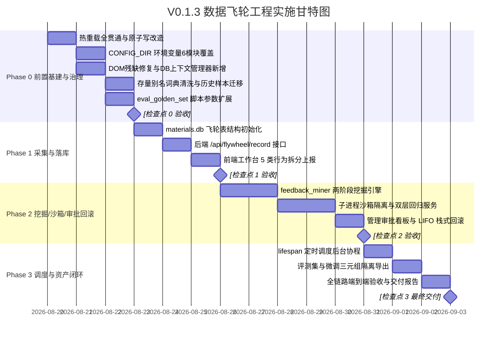

# 物料清单匹配系统 V0.1.3 数据飞轮工程实施计划

本计划严格基于 [data_flywheel_technical_proposal.md (Rev 3.0)](file:///c:/Users/wangd/project/ListTrans/doc/V0.1.3/data_flywheel_technical_proposal.md) 方案与三轮独立技术评审结论制定，采用**检查点门禁制（Checkpoint Gate）**分阶段推进。

---

## 阶段规划概览



---

## User Review Required

> [!IMPORTANT]
> **评审核准的四项关键设计决策**：
> 1. **Phase 0/1 即刻开工**：Phase 0（基建修复）与 Phase 1（采集落库）已完全具备编码条件，优先打通数据采集。
> 2. **沙箱回归采用子进程隔离**：主进程内不触碰任何全局变量与 `lru_cache`，通过 `subprocess` + 临时沙箱 `CONFIG_DIR` 全量拷贝运行评测，杜绝生产流量污染。
> 3. **回归评估采用“双层门禁 + 净收益判定”**：定向子集（含该规则关键词的用例）异步快速回归（要求净收益 $\ge 0$ 且原 Top1 用例不掉出召回），全量 1067 条作为后台异步兜底容差（$\le 0.5\%$）。
> 4. **配置写回与回滚采用“原子写 + LIFO 栈式回滚”**：使用 `os.replace` 消除文件写截断风险；快照回滚严格按时间栈逆序单步回退，并联动将建议置回 `rolled_back`。

---

## 详细实施计划与任务分解

### Phase 0：前置基础设施缺陷修复与数据治理（必须先做）

#### 1. [MODIFY] [db_manager.py](file:///c:/Users/wangd/project/ListTrans/app/db_manager.py)
* 新增 `get_db_cursor(commit=True)` 上下文管理器，支持 `with get_db_cursor() as cur:` 自动事务提交与异常回滚。

#### 2. [MODIFY] [server.py](file:///c:/Users/wangd/project/ListTrans/app/server.py)
* 改造 `/api/config/save`：
  - 引入文件写锁与 `tempfile` + `os.replace` 原子写入。
  - 补齐完整的 6 项重载函数调用：`reload_preprocessor_configs()`、`reload_matcher_configs()`、`reload_normalizer_configs()`、`reload_extractor_configs()`、`reload_router_configs()`、`LLMRuleManager.clear_active_cache()`。

#### 3. [MODIFY] 补齐全库 6 个模块的 `CONFIG_DIR` 环境变量注入支持
* [normalizer.py](file:///c:/Users/wangd/project/ListTrans/app/normalizer.py)
* [preprocessor.py](file:///c:/Users/wangd/project/ListTrans/app/preprocessor.py)
* [matcher.py](file:///c:/Users/wangd/project/ListTrans/app/matcher.py)
* [domain_extractors.py](file:///c:/Users/wangd/project/ListTrans/app/domain_extractors.py)
* [domain_router.py](file:///c:/Users/wangd/project/ListTrans/app/domain_router.py)
* [vector_index.py](file:///c:/Users/wangd/project/ListTrans/app/vector_index.py)
  - 统一支持 `os.getenv("CONFIG_DIR", os.path.join(PROJECT_ROOT, "config"))`。

#### 4. [MODIFY] [index.html](file:///c:/Users/wangd/project/ListTrans/web/index.html)
* 修复 Card 5.5（多物料绑定看板）残缺的 HTML 结构，补齐 `binding-suggestions-tbody` 与 `binding-rules-tbody` 容器，消除 JS 操作 null 异常。

#### 5. [NEW] [scripts/clean_alias_dict.py](file:///c:/Users/wangd/project/ListTrans/scripts/clean_alias_dict.py)
* 编写存量别名词典数据清洗脚本：
  - 消除循环映射（如 `"Y型过滤器" ↔ "铜质Y型过滤器"`）。
  - 消除重复键冲突、消除恒等映射（A ➔ A）。
  - 清理异常换行符与疑似污染条目并输出清洗报告。

#### 6. [NEW] [scripts/migrate_legacy_feedback.py](file:///c:/Users/wangd/project/ListTrans/scripts/migrate_legacy_feedback.py)
* 迁移 `app/feedback_samples.json` 中存量 114 条历史样本至 `materials.db` 的 `flywheel_records` 表，标记 `user_id = 'legacy_anonymous'`。

#### 7. [MODIFY] [eval_golden_set.py](file:///c:/Users/wangd/project/ListTrans/tests/eval_golden_set.py)
* 增加 `--filter-keyword` 与 `--case-ids` 命令行过滤参数，支持针对特定触发词的子集快速评测；输出 JSON 格式明细供子进程解析。

---

### Phase 1：数据采集层与幂等落库

#### 1. [NEW] [app/flywheel_db.py](file:///c:/Users/wangd/project/ListTrans/app/flywheel_db.py)
* 在 `materials.db` 中初始化 4 张核心表与索引：
  - `flywheel_records`（流水表，含 `idx_fwr_session_row` 组合索引）
  - `flywheel_rule_suggestions`（建议表）
  - `flywheel_config_snapshots`（快照表）
  - `flywheel_pattern_aggregates`（归档汇总表）

#### 2. [MODIFY] [server.py](file:///c:/Users/wangd/project/ListTrans/app/server.py)
* 新增 `POST /api/flywheel/record` 路由：
  - 依赖 `current_user = Depends(require_employee)`，从 JWT 注入 `user_id`（存储 username）与 `user_name`。
  - 使用安全的幂等事务：插入新记录后，取新 `new_id` 将同会话同行的历史旧记录更新为 `superseded = 1`。

#### 3. [MODIFY] [web/app.js](file:///c:/Users/wangd/project/ListTrans/web/app.js)
* 重构 `applyMatchCandidate` 等交互逻辑，拆分为 5 类行为上报：
  - `CONFIRM_TOP1`（直接采纳）
  - `PICK_CANDIDATE`（换选推荐）
  - `MANUAL_REPLACE`（全库搜索套用）
  - `PARAM_ADJUST`（特征微调）
  - `BIND_MULTI`（多物料绑定）
* 使用 `crypto.randomUUID()` 生成 `client_event_id`，统一使用 `fetch(url, { keepalive: true })` 进行非阻塞静默上报。

---

### Phase 2：智能挖掘引擎、子进程沙箱双层回归与管理审批/回滚

#### 1. [NEW] [app/feedback_miner.py](file:///c:/Users/wangd/project/ListTrans/app/feedback_miner.py)
* 实现两阶段扫描与挖掘算法：
  - 阶段一：扫描 `is_processed = 0 AND superseded = 0` 提取候选 pattern；
  - 阶段二：全表全量统计 Support、Distinct Users、Consistency；
  - 领域词表正向最大匹配提取词片段，放行字母缩写通道（`AP`, `AL`, `PAF` 等）；
  - 门禁分级：`pending`（$\ge 3$ 次、$\ge 2$ 人、$\ge 80\%$）、`observing`（$\ge 2$ 次观察池）。

#### 2. [NEW] [app/flywheel_sandbox.py](file:///c:/Users/wangd/project/ListTrans/app/flywheel_sandbox.py)
* 实现子进程沙箱隔离评估服务：
  - 建立全局 `asyncio.Lock()` 评测互斥锁；
  - 创建临时沙箱目录（全量复制当前 `config/` 目录并应用待生效规则）；
  - `subprocess.Popen` 调用 `tests/eval_golden_set.py` 执行定向子集回归与全量异步回归；
  - 实施双层门禁与净收益判定逻辑（未命中统一记为 999 哨兵值）。

#### 3. [MODIFY] [server.py](file:///c:/Users/wangd/project/ListTrans/app/server.py)
* 补充管理 API：
  - `GET /api/flywheel/statistics`
  - `GET /api/flywheel/suggestions`（支持 pending / observing）
  - `POST /api/flywheel/suggestions/eval`（启动异步回归，返回 `task_id`）
  - `GET /api/flywheel/eval/{task_id}`（轮询回归进度与指标变化）
  - `POST /api/flywheel/suggestions/accept`（支持 `edited_target_value`，原子写 + 写入快照 + 热重载）
  - `POST /api/flywheel/suggestions/reject`
  - `POST /api/flywheel/rollback`（LIFO 栈式回滚，联动 suggestion 状态回退至 `rolled_back`）

#### 4. [MODIFY] [web/admin.html](file:///c:/Users/wangd/project/ListTrans/web/admin.html) 或 [web/index.html](file:///c:/Users/wangd/project/ListTrans/web/index.html)
* 落地【数据飞轮与智能规则演化】管理看板：大盘统计、待审列表、微调采纳、异步进度条、快照历史与一键回滚。

---

### Phase 3：后台定时调度、资产导出与全链路验收

#### 1. [MODIFY] [server.py](file:///c:/Users/wangd/project/ListTrans/app/server.py)
* 在 `lifespan` 启动后台 asyncio 周期任务，每日凌晨 02:00 自动执行增量挖掘与 pattern 汇总。

#### 2. [MODIFY] [server.py](file:///c:/Users/wangd/project/ListTrans/app/server.py)
* 实现 `GET /api/flywheel/export/benchmark`（带 `source = 'flywheel_auto'` 隔离标记导出 Excel）。
* 实现 `GET /api/flywheel/export/triplets`（过滤参数噪声导出 BGE 向量微调 JSONL）。

#### 3. [NEW] [tests/test_flywheel_end2end.py](file:///c:/Users/wangd/project/ListTrans/tests/test_flywheel_end2end.py)
* 编写端到端全链路自动化测试，覆盖采集 ➔ 挖掘 ➔ 沙箱拦截 ➔ 采纳生效 ➔ 栈式回滚全闭环。

---

## 验证计划与检查点门禁

### 自动化测试
```powershell
# 1. 验证 Phase 0 热重载与原子写
pytest tests/test_hot_reload.py -v

# 2. 验证 Phase 1 采集与幂等写入
pytest tests/test_flywheel_record.py -v

# 3. 验证 Phase 2 挖掘门禁与沙箱回归评估
pytest tests/test_feedback_miner.py -v
pytest tests/test_flywheel_sandbox.py -v

# 4. 验证 Phase 3 全链路端到端闭环与回滚
pytest tests/test_flywheel_end2end.py -v
```

### 阶段检查点验收标准
1. **[检查点 0 验收]**：API 修改别名后无须重启，`/api/match` 立即返回新名称；存量别名词典无死循环；绑定看板 DOM 渲染无报错。
2. **[检查点 1 验收]**：前端 5 类行为正常上报，重复提交不重复计数，`superseded` 标志正确更新。
3. **[检查点 2 验收]**：单人误操作被多人共识门禁正确拦截；有害规则被沙箱定向回归精准阻断；采纳规则后执行一键回滚能 100% 恢复配置文件与建议状态。
4. **[检查点 3 验收]**：凌晨定时调度稳定运行，评测集与微调资产导出格式合规且隔离无泄漏。
