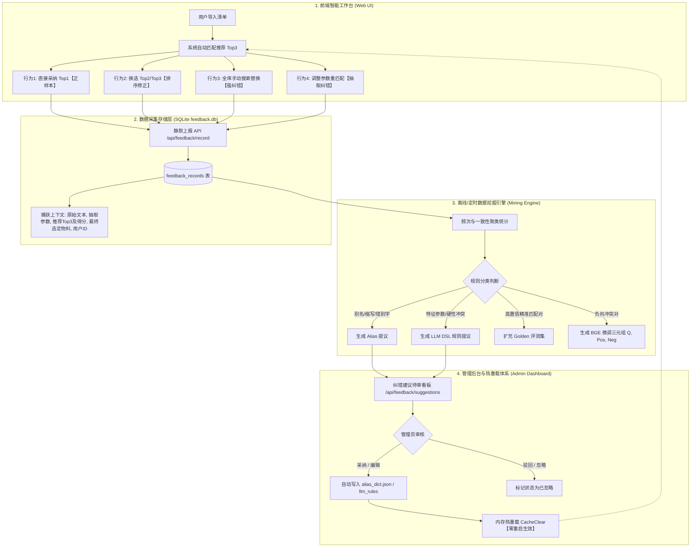

# 武汉华康世纪洁净科技股份有限公司 · 物料清单匹配系统 V0.1.3
## 数据飞轮（Data Flywheel）技术实现方案与架构设计

> **版本**：V0.1.3  
> **状态**：待规划实施（Planned）  
> **核心目标**：打造生产环境可用、可闭环、低人工干预的“人工修改反馈 ➔ 自动挖掘提炼 ➔ 规则与模型自进化”数据飞轮。

---

## 目录
- [一、背景与核心诉求](#一背景与核心诉求)
- [二、总体架构与数据流全景图](#二总体架构与数据流全景图)
- [三、数据采集与存储设计（全量上下文捕获）](#三数据采集与存储设计全量上下文捕获)
- [四、前端行为捕获与交互闭环](#四前端行为捕获与交互闭环)
- [五、聚合分析与规则挖掘引擎算法](#五聚合分析与规则挖掘引擎算法)
- [六、三级知识沉淀通道与管理审批看板](#六三级知识沉淀通道与管理审批看板)
- [七、API 接口规格定义](#七api-接口规格定义)
- [八、实施阶段规划与评审检查点](#八实施阶段规划与评审检查点)
- [九、并发、安全与性能保障](#九并发安全与性能保障)

---

## 一、背景与核心诉求

随着系统正式铺开使用，一线工程师在【智能工作台】界面的每一次交互（直接确认、下拉换选候选、全库手动搜索替换物料、调整特征参数重新匹配）均包含极高价值的领域专业先验知识。

### 1.1 核心痛点
1. **反馈数据零散/未充分利用**：旧版本仅将部分纠错记录于简单 JSON 文件，未采集完整的系统预测轨迹（如当时推荐的 Top-3 候选及得分）、特征提取上下文与用户行为类型。
2. **缺乏自动聚合归纳能力**：高频错别字、设备简称（如 `AP-1` 对应 `动力配电箱`、`PAF` 对应 `过滤单元`）无法自动升华为规则，仍需人工手动编写。
3. **缺少安全审批流与热加载闭环**：新规则无法一键审核、无法安全无缝地热重载到运行中的服务。

### 1.2 V0.1.3 建设目标
1. **全量静默采集**：前端零额外操作成本，自动捕获用户的 4 类决策动作与完整上下文。
2. **高频规律自动挖掘**：后台智能归纳频次（Support Count）与一致性（Consistency Ratio），自动生成别名建议和 DSL 规则建议。
3. **管理端一键审批与热加载**：在管理后台提供可视化看板，支持一键采纳、编辑或驳回，秒级热重载生效。
4. **高质量数据回流**：自动产出黄金评测集用例与向量模型对比微调三元组（Triplets）。

---

## 二、总体架构与数据流全景图



---

## 三、数据采集与存储设计（全量上下文捕获）

为了满足高并发、持久化存储以及高效统计聚合，在 `app/` 下设立独立的 `feedback.db`（或纳入主库表结构）：

### 3.1 核心数据表：`feedback_records`（用户反馈操作流水表）

```sql
CREATE TABLE IF NOT EXISTS feedback_records (
    id INTEGER PRIMARY KEY AUTOINCREMENT,
    session_id TEXT NOT NULL,                  -- 会话ID (清单批次)
    row_idx INTEGER NOT NULL,                  -- 行号
    discipline TEXT DEFAULT '',                -- 专业分类 (如: 暖通/给排水/强电/弱电/装饰)
    raw_name TEXT NOT NULL,                    -- 原始设备/材料名称
    raw_spec TEXT DEFAULT '',                  -- 原始规格描述
    raw_unit TEXT DEFAULT '',                  -- 原始单位
    raw_category TEXT DEFAULT '',              -- 原始甲供分类
    extracted_params TEXT DEFAULT '{}',        -- 当时解析出的特征参数 (JSON 字符串)
    
    -- 算法预测轨迹
    auto_top1_code TEXT DEFAULT '',            -- 系统推荐首选项物料编码
    auto_top1_score REAL DEFAULT 0.0,          -- 首选项得分 (0~100)
    auto_top1_name TEXT DEFAULT '',            -- 首选项名称
    auto_top1_spec TEXT DEFAULT '',            -- 首选项规格
    auto_candidates_json TEXT DEFAULT '[]',    -- 当时召回推荐的 Top3 完整列表 (JSON)
    
    -- 用户决策动作
    action_type TEXT NOT NULL,                 -- CONFIRM_TOP1 / PICK_CANDIDATE / MANUAL_REPLACE / PARAM_ADJUST
    
    -- 最终确认标准物料
    final_target_code TEXT NOT NULL,           -- 最终选定的标准物料编码
    final_target_name TEXT DEFAULT '',         -- 最终物料标准名称
    final_target_spec TEXT DEFAULT '',         -- 最终物料标准规格
    final_target_category TEXT DEFAULT '',     -- 最终物料分类
    
    -- 审计与追踪
    user_id TEXT NOT NULL,                     -- 操作人工号/账号
    user_name TEXT DEFAULT '',                 -- 操作人姓名
    is_processed INTEGER DEFAULT 0,            -- 挖掘引擎是否已处理 (0: 未处理, 1: 已处理)
    created_at TIMESTAMP DEFAULT CURRENT_TIMESTAMP
);

CREATE INDEX IF NOT EXISTS idx_fb_action_type ON feedback_records(action_type);
CREATE INDEX IF NOT EXISTS idx_fb_raw_name ON feedback_records(raw_name);
CREATE INDEX IF NOT EXISTS idx_fb_final_code ON feedback_records(final_target_code);
CREATE INDEX IF NOT EXISTS idx_fb_created_at ON feedback_records(created_at);
```

### 3.2 建议规则沉淀表：`feedback_rule_suggestions`（挖掘出的建议规则库）

```sql
CREATE TABLE IF NOT EXISTS feedback_rule_suggestions (
    id INTEGER PRIMARY KEY AUTOINCREMENT,
    suggestion_type TEXT NOT NULL,             -- ALIAS (别名) / DSL_RULE (动态规则) / PARAM_EXTRACT (参数修正)
    source_pattern TEXT NOT NULL,              -- 原始模式/触发词 (如: "AP-1", "脱水紫铜")
    target_value TEXT NOT NULL,                -- 建议映射值/规则内容 (如: "动力配电箱", "脱脂紫铜")
    discipline TEXT DEFAULT '通用',            -- 适用专业
    support_count INTEGER DEFAULT 1,           -- 历史支持样本数 (命中人次)
    confidence REAL DEFAULT 1.0,               -- 置信度 (0.0 ~ 1.0)
    sample_ids_json TEXT DEFAULT '[]',         -- 关联的 feedback_records ID 列表
    status TEXT DEFAULT 'pending',             -- pending (待审) / accepted (已采纳) / rejected (已驳回) / auto_applied (自动应用)
    reviewer_id TEXT DEFAULT '',               -- 审核人
    reviewed_at TIMESTAMP,                     -- 审核时间
    created_at TIMESTAMP DEFAULT CURRENT_TIMESTAMP
);

CREATE INDEX IF NOT EXISTS idx_sug_status ON feedback_rule_suggestions(status);
CREATE INDEX IF NOT EXISTS idx_sug_pattern ON feedback_rule_suggestions(source_pattern);
```

---

## 四、前端行为捕获与交互闭环

在 [web/app.js](file:///c:/Users/wangd/project/ListTrans/web/app.js) 的核心交互节点加入非阻塞静默上报：

| 用户行为 | 触发时机 | 上报 `action_type` | 数据价值 |
| :--- | :--- | :--- | :--- |
| **一键采纳首选** | 点击【确认匹配完成】且首选未被更改 | `CONFIRM_TOP1` | **强正样本**：确认系统首选无误 |
| **选择第2/3候选** | 用户点击第 2 或第 3 张推荐卡片进行套用 | `PICK_CANDIDATE` | **排序修正样本**：特征召回正确但精排次序有偏差 |
| **手动搜索替换** | 用户点击【全库搜索并替换】选择新物料 | `MANUAL_REPLACE` | **强纠错样本**：系统未召回或首选项错误，需挖掘别名 |
| **调整参数重匹配** | 用户点击特征标签或【补全参数】并重新匹配 | `PARAM_ADJUST` | **特征提取样本**：表明正则抽取存在盲区 |

> 📌 **性能保障**：前端上报使用 `navigator.sendBeacon` 或异步 `fetch`，完全在后台运行，不阻塞用户界面的任何切行或制表操作。

---

## 五、聚合分析与规则挖掘引擎算法

在 [app/feedback_miner.py](file:///c:/Users/wangd/project/ListTrans/app/feedback_miner.py) 中实现智能聚合算法：

### 5.1 别名与同义词挖掘（Alias Mining）
1. **过滤与分组**：提取所有 `action_type == 'MANUAL_REPLACE'` 的记录，按 `(清洗后的 raw_name, final_target_name)` 分组聚合。
2. **置信度计算**：
   $$\text{Support} = \text{该映射出现次数}$$
   $$\text{Consistency} = \frac{\text{该原始词映射到当前物料的次数}}{\text{该原始词被手动替换的总次数}}$$
3. **触发门禁**：
   - 当 $\text{Support} \ge 2$ 且 $\text{Consistency} \ge 80\%$ 时，生成一条待审建议：`source_pattern ➔ target_value`。
   - 当 $\text{Support} \ge 5$ 且 $\text{Consistency} \ge 95\%$ 时，标记为高置信度推荐（推荐默认勾选采纳）。

### 5.2 规格冲突与硬门禁提炼（Negative Constraint Mining）
- 若发现系统持续推荐了某类特定候选物料（如某种铝芯电缆），但所有工程师一致将其替换为铜芯电缆，系统自动提炼出反向排除规则（`must_not_contain: ["铝"]`）。

---

## 六、三级知识沉淀通道与管理审批看板

### 6.1 沉淀通道

1. **通道 ①：词典与同义库（`config/alias_dict.json`）**
   - 审核通过后，自动追加键值对并调用 `reload_preprocessor_configs()` 和 `reload_normalizer_configs()` 内存热重载。
2. **通道 ②：动态规则库（`config/llm_rules.json`）**
   - 审核通过后，直接注入 `LLMRuleManager` 动态规则引擎，在后续匹配计算中实时生效。
3. **通道 ③：训练与评测数据资产**
   - 自动生成符合 Sentence-Transformers 的对比学习三元组：
     - `Anchor (Query)`: 原始清单文本
     - `Positive`: 用户最终确认的物料文本
     - `Hard Negative`: 系统当时错误推荐但被用户驳回的首选项物料文本

### 6.2 管理端看板设计（在 `web/admin.html` 新增 Tab）

- **Tab 名**：`【数据飞轮与纠错建议】`
- **功能包含**：
  - 📊 **飞轮运行大盘**：已采集操作总数、自动确认率、人工纠错率、已沉淀规则数。
  - 📝 **待审核建议列表**：卡片式展现【原始触发词 ➔ 建议替换词 / 规则】、支持人次、置信度，提供【一键采纳】、【编辑并采纳】、【驳回】按钮。
  - 🔄 **一键热重载**：提供热重载按钮与操作日志。
  - 📥 **数据导出专区**：一键导出《金标回归评测集.xlsx》和《微调训练三元组.jsonl》。

---

## 七、API 接口规格定义

| Method | Endpoint | 权限要求 | 描述 |
| :--- | :--- | :--- | :--- |
| `POST` | `/api/feedback/record` | 登录用户 | 前端静默上报单条/批量操作流水 |
| `GET` | `/api/feedback/statistics` | 管理员 | 获取飞轮统计指标与大盘数据 |
| `GET` | `/api/feedback/suggestions` | 管理员 | 获取系统挖掘出的待审核建议列表 |
| `POST` | `/api/feedback/suggestions/review` | 管理员 | 批量审核建议（采纳/编辑/驳回） |
| `POST` | `/api/feedback/miner/run` | 管理员 | 手动触发一次增量数据挖掘与模式聚类 |
| `GET` | `/api/feedback/export/benchmark` | 管理员 | 导出最新标注好的评测集 Excel |
| `GET` | `/api/feedback/export/triplets` | 管理员 | 导出用于向量模型微调的 JSONL 格式三元组 |

---

## 八、实施阶段规划与评审检查点

```
阶段 1: 基础设施与数据采集 (预计 1 天)
  ├─ 1.1 建立 feedback.db 数据库与表结构 (含迁移脚本)
  ├─ 1.2 后端接入 /api/feedback/record 接口
  └─ 1.3 前端智能工作台埋点 4 类用户行为
  └─ [检查点 1]: 本地/测试服验证操作流水能精准入库

阶段 2: 挖掘引擎与管理看板 (预计 1.5 天)
  ├─ 2.1 编写 feedback_miner.py 聚合算法与规则提炼
  ├─ 2.2 在 admin.html 实现【数据飞轮与纠错建议】看板
  ├─ 2.3 实现审核通过后的配置自动写回与热重载
  └─ [检查点 2]: 模拟多条纠错数据，验证自动生成建议并一键采纳生效

阶段 3: 评测集回流与导出工具 (预计 0.5 天)
  ├─ 3.1 接入评测集自动化导出与 Triplet 格式化
  ├─ 3.2 编写端到端自动化测试用例
  └─ [检查点 3]: 完整走通数据飞轮全链路闭环，出具 V0.1.3 验收报告
```

---

## 九、并发、安全与性能保障

1. **SQLite 线程安全与 WAL 模式**：
   - `feedback.db` 启用 `PRAGMA journal_mode=WAL;`，支持多连接并发读写，防止锁表。
2. **前后端解耦与防刷保护**：
   - 每次清单导入和保存时支持批量上报，单条操作具备防抖（Debounce）处理。
3. **数据隔离与审计合规**：
   - 记录每次纠错操作的 `user_id` 与时间戳，确保规则提炼可追溯、可审计。

---

> **评审说明**：  
> 请审阅本技术方案。待您评审通过、提出修改意见或明确指示后，我将严格按照批复的方案推进具体代码的开发与落地。
