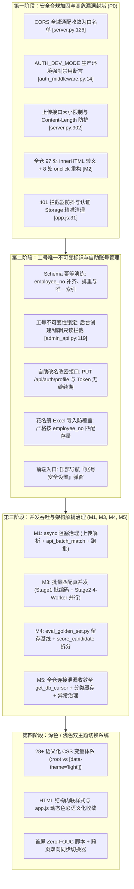

# ListTrans V0.1.4 架构整改与功能升级实施方案（修订版）

- **版本号**：V0.1.4 (Rev.2)
- **基线版本**：V0.1.3 (`commit 9ab14133413736e60fe5ecc82c36b288931e4521`)
- **修订日期**：2026-11-11
- **修订说明**：基于《V0.1.4_审核小结.md》全面修正 12 项数据/行号/签名勘误，补齐 4 项高危安全漏洞与 6 项中危架构缺陷，并将 M2（XSS 安全净化）与主题改造彻底解耦分阶段实施。

---

## 一、 总体升级全景图



---

## 二、 核心代码与架构缺陷整改方案（修订核准版）

### M1 [P0]：解除主事件循环中所有同步阻塞（扩大整改面）

#### 1. 缺陷准确定位
- **原上传接口**：`app/server.py:689` `async def async_process_upload_task(task_id: str, temp_path: str)`（形参无 `filename`）。第 691 行起 `openpyxl.load_workbook` 同步阻塞，直至 849 行 `wb.close()`，862 行后才进入线程池。
- **关联阻塞端点（审核新发）**：
  - `app/server.py:1206` `api_batch_match` 路由直接同步调用 `batch_match_rows`；
  - `app/server.py:1228`、`1271` 单项匹配直接同步调用 `match_item`；
  - `app/server.py:74` `_daily_flywheel_mining_loop` 在循环中直接同步执行 `miner.run_mining()`。

#### 2. 整改技术方案
1. **剥离纯同步解析函数**：
   ```python
   def _parse_and_prepare_upload_excel(task_id: str, temp_path: str) -> tuple:
       """纯同步执行 Excel I/O、Sheet 遍历清洗与行预处理"""
       ...
   ```
2. **全面 run_in_executor 卸载**：
   - 在 `async_process_upload_task` 起始处通过 `await loop.run_in_executor(executor, _parse_and_prepare_upload_excel, task_id, temp_path)` 卸载。
   - 对 `api_batch_match`、单项匹配路由以及 `miner.run_mining()` 同步操作一律包裹 `await loop.run_in_executor(executor, ...)`。
3. **取消信号与内存回收**：
   在解析循环中每 50 行检查一次取消信号，遇到取消立即 `wb.close()` 并释放内存。

---

### M2 [P0]：前端存储型 XSS 全量防护与 401 弹窗防抖

#### 1. 缺陷准确定位（全仓实测）
- **`web/app.js`**：实测 **62 处** `.innerHTML` 动态赋值，包含物料名、规格型号、品牌、推荐理由、分类等，全文件无任何 HTML 转义；另有 **8 处**动态 `onclick` 拼接未转义字符串（第 2891、2892、3345–3350、3536–3537 行等）。
- **`web/admin.html`**：实测 **35 处** `.innerHTML` 动态赋值（第 1923 行 `u.role`、第 2950 行 `target_type` 等仍裸插值）。
- **`web/app.js:31-35`**：401 拦截器直接 `localStorage.clear()` 且并发多请求触发多次 `alert`。

#### 2. 整改技术方案
1. **统一注入全局转义函数**：
   ```javascript
   function escapeHtml(val) {
       if (val === null || val === undefined) return '';
       return String(val)
           .replace(/&/g, '&amp;')
           .replace(/</g, '&lt;')
           .replace(/>/g, '&gt;')
           .replace(/"/g, '&quot;')
           .replace(/'/g, '&#39;');
   }
   ```
2. **全仓 97 处 `.innerHTML` 与 8 处 `onclick` 治理**：
   - 对所有动态插值变量一律经由 `escapeHtml(...)` 处理后再拼接模板。
   - 8 处 `onclick="foo('${val}')"` 彻底改为通过 `data-*` 属性存储安全值，采用事件委托统一派发，阻断 DOM-based / Stored XSS 链。
3. **401 拦截器防抖与精准清理**：
   ```javascript
   let _isHandling401 = false;
   const AUTH_STORAGE_KEYS = ['token', 'username', 'name', 'position', 'role']; // 严格匹配现状 5 个 Key
   if (response.status === 401) {
       if (!_isHandling401) {
           _isHandling401 = true;
           AUTH_STORAGE_KEYS.forEach(k => localStorage.removeItem(k));
           alert('登录状态已过期或账号信息已变更，请重新登录！');
           window.location.href = '/login.html';
       }
   }
   ```

---

### M3 [P1]：批量匹配 `batch_match_rows` 真并发改造

#### 1. 缺陷准确定位与前提纠正
- **Executor 定义位置**：`app/server.py:612`。
- **串行匹配循环位置**：`app/server.py:1050`（遍历）及 `1058` 行（逐条串行 `match_item`）。
- **连接模型纠正**：`app/db_manager.py:47-56` 的 `get_db_connection()` 每次均新建连接，**无 threading.local**；具备 `threading.local` 特性的是 `get_thread_db_connection()`（第 15–42 行）。
- **无锁全局字典**：`app/server.py:614` 与 `687` 重复声明 `upload_tasks = {}`，跨事件循环与 Worker 线程并发读写存在竞态。

#### 2. 整改技术方案
1. **两阶段流水线架构**：
   - **Stage 1 (向量批量编码)**：单线程集中调用 `encode_batch(batch_queries)`，充分发挥 PyTorch / ONNX 底层 C++ 矩阵加速，避免多线程锁竞争。
   - **Stage 2 (4-Worker 并发召回打分)**：使用 `_row_match_executor = ThreadPoolExecutor(max_workers=4)` 并行执行 `match_item`。
2. **显式使用 `get_thread_db_connection()`**：
   多线程 Worker 内严格使用 `get_thread_db_connection()`，实现线程级单例连接复用，根除竞态与句柄频繁开销。
3. **线程安全与状态保护**：
   - 引入 `_upload_tasks_lock = threading.Lock()` 保护 `upload_tasks` 字典的更新；
   - 匹配进度计数使用局部 `progress_lock = threading.Lock()` 原子累加；
   - 任务结果按原始行索引 `idx` 写回，保证结果顺序与原表绝对一致。

---

### M4 [P1]：超长核心函数 `score_candidate` 模块化重构

#### 1. 真实签名、返回值与现状确认
- **实际函数签名**：`score_candidate(query_info, candidate, semantic_score: float = 0.0) -> Tuple[float, List[str]]`（第 268–1491 行，共 1223 行）。
- **参数名澄清**：真实参数名为 `semantic_score`，非 `precomputed_vector_sim`；返回值为二元组 `(score, reasons)`。
- **现状勘误**：第 1022–1024 行 `q_fan_vol` 已预赋初值，不再是未绑定隐患；但 1200+ 行的代码结构仍急需解耦治理。
- **测试基线前提**：仓库内真实黄金集脚本为 `tests/eval_golden_set.py`（原引用的 `evaluate_accuracy.py` 不存在）。**重构前必须先跑通 `eval_golden_set.py` 并留存基线快照。**

#### 2. 整改技术方案
1. **上下文对象定义（对齐真实二元组）**：
   ```python
   @dataclass
   class ScoringContext:
       query_info: Dict[str, Any]
       candidate: Dict[str, Any]
       semantic_score: float = 0.0
       score: float = 0.0
       reasons: List[str] = field(default_factory=list)
       # 预解析常用属性与通用状态
       q_name: str = ""
       c_name: str = ""
       q_spec: str = ""
       c_spec: str = ""
       q_attrs: Dict[str, Any] = field(default_factory=dict)
       c_attrs: Dict[str, Any] = field(default_factory=dict)
       is_hard_rejected: bool = False
   ```
2. **7 阶段流水线组织**：
   拆分为 7 个纯函数子模块，保持原有业务公式与加减分权重零修改。
3. **零退化验证**：
   以 `tests/eval_golden_set.py` 为基线，重构前后逐行逐例校验，确保得分与命中 Candidate 100% 一致。

---

### M5 [P2]：数据库连接收口、分类缓存、异常治理与工作区清理

1. **统一使用 `get_db_cursor` 上下文管理器**：
   收拢全仓连接泄漏点（`server.py:377, 521, 570, 2086`、`session_manager.py` 全部 11 个函数、`audit_manager.py`、`vector_index.py:404`、`llm_rule_engine.py`），统一采用仓库现成的 `with get_db_cursor(...) as cursor:` 规范模式，由上下文管理器确保自动提交与异常闭合。
2. **物料分类全表扫描缓存**：
   在 `app/server.py:570` 处设立模块级内存缓存 `_material_categories_cache`，仅在物料库导入/更新时主动失效。
3. **异常精准化与日志诊断**：
   清理 `app/query_preprocessor.py`、`app/db_manager.py` 中的裸 `except: pass`，区分 `ValueError`、`TypeError`、`json.JSONDecodeError`，并补齐 `logger.debug`。
4. **硬编码清理与 Git 规则加固**：
   - 修正 `app/vector_index.py:340`（消除重复段 `ListTrans/ListTrans` 并改为相对项目根路径）与 `tests/build_golden_set.py:29`。
   - 删除 `app/*.bak*` 文件；将 `.gitignore` 中的 `*.bak` 强化为 `*.bak*`（包含 `.bak-shm` / `.bak-wal`）。

---

## 三、 补齐的高危与中危安全/架构项（评审新增）

1. **[高危] CORS 全域通配收敛**：
   `app/server.py:126-132` 移除 `allow_origin_regex=r"https?://.*"` 与盲目 `allow_credentials=True`，正式启用并校验 `ALLOWED_ORIGINS` 白名单（支持环境变量注入），默认仅允许同源与已配置域名。
2. **[高危] AUTH_DEV_MODE 生产启动断言**：
   在 `app/auth_middleware.py` 启动阶段增加断言：若当前处于非开发环境（或未显式配置 `APP_ENV=development`），严禁启用 `AUTH_DEV_MODE`，从根源杜绝免密提权后门。
3. **[高危] 上传文件请求体大小硬性限制**：
   在 `/api/upload` 增加 `MAX_UPLOAD_SIZE = 50 * 1024 * 1024`（50MB）上限检查及 SpooledTemporaryFile 限制，防止内存/磁盘耗尽 DoS 攻击。
4. **[中危] 生产环境安全加固**：
   - `app/server.py:57` 的 `ENABLE_DOCS` 默认设置为 `False`（按环境变量开启）。
   - `app/auth_manager.py:28-32` 的 `SECRET_KEY` 在生成环境未配置时抛出致命错误，杜绝随机生成导致的重启 JWT 失效与验签伪造风险。
   - `app/matcher.py:1695` 修复可变默认参数 `batch_confirmed_series: List[str] = []` 改为 `Optional[List[str]] = None`。

---

## 四、 新增需求 1：以“工号”为唯一不可变标识 + 用户自助修改登录名与密码

### 1. 业务与安全规则
1. **工号（`employee_no`）永久不可变**：
   - 后台新增用户 (`POST /api/admin/users`)：`employee_no` 为必填项。
   - 后台编辑用户 (`PUT /api/admin/users/{user_id}`)：若传入 `employee_no` 且与数据库原值不一致，直接拦截并返回 `400 Bad Request: "工号为账号唯一标识，创建后不可修改"`。
2. **数据库迁移与防冲突策略**：
   - 先执行数据核验 SQL，导出可能存在的重复工号人工确认，不盲目静默加后缀；
   - 补齐默认内置系统账号工号为 `SYS_ADMIN`，未填写工号的存量普通员工补充 `EMP_` + 4 位编号，建立 `UNIQUE INDEX idx_users_employee_no ON users(employee_no)`。
   - 在 `username` 与 `phone` 上建立唯一索引（含 NULL 过滤），在引擎层兜底跨字段登录防歧义。
3. **花名册 Excel 导入防覆盖**：
   修改 `import_users_from_excel`：严格以 `employee_no` 作为主键匹对。存在时仅同步部门、岗位、姓名、手机号，**保留用户自定义的 `username` 与密码**。
4. **用户自助修改接口 `PUT /api/auth/profile`**：
   - 请求体统一使用 `new_username`、`old_password`、`new_password`。
   - 无论改名还是改密均强制核验当前 `old_password`。
   - 改名成功后同步原子更新 `active_heartbeats` 的 `username` 字段，并在 `audit_logs` 中记录不可变的 `user_id` 与 `employee_no`。
   - 重签 JWT Token（Payload 携带 `sub`, `uid`, `emp_no`, `role`），前端精准更新已存在的 5 个 Key，实现平滑无感续期。

---

## 五、 新增需求 2：深色 / 浅色双主题切换系统（解耦独立实施）

### 1. 实施原则：与 M2（XSS 安全治理）完全解耦
- 为保证 Code Review 与安全审计清晰，**XSS 转义加固先行完成并上线**，双主题样式改造作为独立批次实施。

### 2. 全量色值普查与 28+ 语义变量扩容
基于对 `admin.html`（144 hex/85 rgba）、`index.html`（120 hex/482 内联 style）、`app.js`（24 hex/13 rgba）的全量普查，将变量表扩充至 28 个：
- 基础层：`--bg-base`, `--bg-surface`, `--bg-surface-elevated`, `--bg-surface-glass`, `--bg-input`, `--bg-subtle`, `--bg-hover`
- 文本层：`--color-text-primary`, `--color-text-secondary`, `--color-text-muted`, `--color-accent-text`
- 边框与阴影：`--border-color`, `--border-color-hover`, `--shadow-elevated`, `--shadow-card`
- 状态语义色组：`--color-success`, `--color-success-bg`, `--color-warning`, `--color-warning-bg`, `--color-danger`, `--color-danger-bg`, `--color-info`, `--color-info-bg`
- 业务图表与指标：`--color-chart-cpu`, `--color-chart-ram`, `--color-chart-disk`

### 3. 三步渐进实施路线
1. **Step 1 (Token 定义与防闪烁)**：在 `index.css`、`login.css` 及 `admin.html` 落地 28 个变量，注入 `<head>` 内联防 FOUC 脚本与导航栏切换按钮。
2. **Step 2 (HTML 结构内联样式收敛)**：将 `index.html` 与 `admin.html` 中写死的数百处深色背景与浅灰文字抽离为语义类。
3. **Step 3 (app.js 动态渲染色值收敛)**：将 JS 动态输出的 Candidate 卡片与 Badge 配色替换为语义变量。

---

## 六、 阶段执行计划与里程碑

| 阶段 | 交付核心内容 | 重点操作文件 | 验收标准 |
| :--- | :--- | :--- | :--- |
| **Phase 1: 安全基线** | 1. CORS 白名单与 DEV_MODE 断言<br/>2. 上传文件大小限制<br/>3. 全仓 97 处 innerHTML 转义 + 8 处 onclick 改造<br/>4. 401 防抖与 Storage 精准清理 | `app/server.py`<br/>`app/auth_middleware.py`<br/>`web/app.js`<br/>`web/admin.html` | XSS 注入用例完全阻断；401 并发请求单次提示；CORS 非法跨域拦截。 |
| **Phase 2: 账号体系** | 1. 数据库迁移脚本与演练<br/>2. 后台工号锁定逻辑<br/>3. `PUT /api/auth/profile` 自助改名改密与 Token 续期<br/>4. 花名册导入防覆盖<br/>5. 前端「账号安全设置」弹窗 | `app/auth_manager.py`<br/>`app/admin_api.py`<br/>`app/server.py`<br/>`web/app.js`<br/>`web/index.html`<br/>`web/admin.html` | 存量工号 100% 唯一且锁定不可变；多维登录成功；改名改密平滑保持会话。 |
| **Phase 3: 并发与架构** | 1. 运行 `eval_golden_set.py` 留存基线快照<br/>2. M1 范围阻塞卸载 (上传 + 路由 + 跑批)<br/>3. M3 4-Worker 真并发改造与线程安全加锁<br/>4. M4 `score_candidate` 解耦重构<br/>5. M5 `get_db_cursor` 统一收口与分类缓存 | `tests/eval_golden_set.py`<br/>`app/server.py`<br/>`app/matcher.py`<br/>`app/db_manager.py`<br/>`app/vector_index.py` | 大表上传主线程 0 阻塞；批量匹配提速 2x+；黄金集评测得分 100% 持平；无连接泄漏。 |
| **Phase 4: 双主题系统** | 1. 28+ 语义变量与防 FOUC 脚本<br/>2. 静态 HTML 内联样式收敛<br/>3. app.js 动态渲染配色适配<br/>4. 跨页面主题切换器联动 | `web/index.css`<br/>`web/login.css`<br/>`web/index.html`<br/>`web/login.html`<br/>`web/admin.html`<br/>`web/app.js` | 登录页、工作台、管理后台一键无缝双向切换；无白底白字；刷新无黑白闪烁。 |
| **Phase 5: 多端同步** | 本地测试 $\rightarrow$ Git 打标 $\rightarrow$ 内网与云端生产更新 | 全量代码库 | GitHub、本地、内网、云端四端版本 MD5 一致。 |
